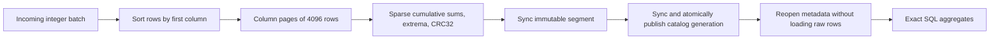

# Disk-backed analytics in KestrelSQL 0.3

The `Archive` path is an append-only SQL analytics store. It writes batches to immutable column segments and answers eligible aggregate queries with sparse indexes. Raw rows stay on disk. The original `Database` API is a separate implementation with transactional, RAM-resident tables; its old 10-million-row and full-prefix limits do not govern Archive.

Version 0.3 adds immutable snapshots, durable identified batches, bounded small-run compaction and a shared decoded-page cache. The concurrent embedded wrapper and replay contract are described in [LIVE_METRICS.md](LIVE_METRICS.md); current evidence is in [V03_RESULTS.md](V03_RESULTS.md).

## Reproduce

PowerShell, from this repository:

```powershell
cargo build --release --locked
python -m pip install -r benchmarks\requirements.txt
python benchmarks\archive_verify.py --binary target\release\kestrel.exe
python benchmarks\nyc_pipeline.py --binary target\release\kestrel.exe
python benchmarks\gold_verify.py
python benchmarks\large_scale.py --binary target\release\kestrel.exe
python benchmarks\random_windows.py --binary target\release\kestrel.exe
```

To regenerate the static charts, install `benchmarks\plot-requirements.txt` and run `python benchmarks\plot_results.py` after both scale reports exist.

The scale suite uses 10 million, 50 million, and 100 million ordered rows, followed by 100 million rows with 5% late timestamps. It persists every row. Kestrel payloads alone occupy about 6.24 GB, with additional space for DuckDB files and temporary datasets. Reference execution uses one thread and a 256 MB DuckDB buffer-manager limit. The latter is not a total-process memory cap; actual peak working sets are recorded separately. Published results come from a live Windows machine, with uncontrolled OS caches and other applications running. `gold_verify.py` checks the join, complete calendar spine, window functions, and daily reconciliation in `portfolio/gold_analysis.sql`; it locates the database through the NYC report unless `--database` is supplied.

To try a smaller example with the bundled Windows executable:

```powershell
.\bin\kestrel.exe --archive ..\..\work\new-demo --scale 1000000 7 --late
.\bin\kestrel.exe --archive ..\..\work\new-demo --sql "SELECT COUNT(*), SUM(value), AVG(value) FROM events WHERE ts >= 200317 AND ts < 700123"
```

`--scale` requires an empty archive. Normal queries reopen an existing archive. Default schema: `events(ts BIGINT, value BIGINT, device BIGINT)`, with non-null signed integers. Use `--columns` with comma-separated identifiers when importing another integer schema. On Linux, use the executable path without `.exe`; Linux CI is configured but was not executed during local qualification.

## Ingest and query

```rust
use kestrel_sql::archive::Archive;

fn main() -> Result<(), Box<dyn std::error::Error>> {
    let mut archive = Archive::open("event-archive", "events", &["ts", "value", "device"])?;
    // Batch order may be arbitrary. Rows retain their associations during sorting.
    archive.append(vec![vec![102, 100, 101], vec![25, 12, 18], vec![1, 1, 2]])?;
    let result = archive.query("SELECT COUNT(*), SUM(value) FROM events WHERE ts >= 100 AND ts < 102")?;
    assert!(result.bytes_read > 0);
    archive.verify()?; // Read every payload page and check its aggregate index.
    Ok(())
}
```

Each anonymous `append` publishes one atomic segment and repeating it repeats its events. `append_once(id, columns)` persists a SHA-256 payload identity and a receipt; exact retries return the original receipt without duplicating rows. `append_group` validates all members before publishing one combined segment and their receipts. It is an ingestion group, not a SQL transaction with UPDATE/DELETE. The original NYC portfolio pipeline still creates a fresh target per rebuild; the additional live pipeline demonstrates identified incremental retries.

`--import-i64 FILE` streams a headerless row-major file of little-endian signed 64-bit integers into segments. The caller supplies column order and schema. The importer checks complete-row alignment before ingesting, caps its batch size, then verifies all published blocks. The provenance sidecar records the exported file's SHA-256; this binary interface is an internal, explicitly typed interchange format, not a general data ingestion protocol.

Archive SQL supports COUNT(*), SUM, AVG, MIN, MAX, comparisons joined by AND, one GROUP BY column, ORDER BY an output name, and LIMIT. Projected columns must be the grouping key. Values are BIGINT, exact sums are i128, and averages are f64. Raw row projection, SELECT *, joins, nullable columns, SQL DDL, and transaction statements use other tools or remain unsupported in this API. Unsupported syntax fails explicitly.

Schema identifiers are unquoted ASCII and are normalized to lowercase; SQL lookup is case insensitive. Duplicate column names differing only in case are rejected.

## Data path



Segments contain at most one million rows. Every 4,096-row page has a checksum, endpoint, minimum, maximum, and cumulative aggregate checkpoint. Segment metadata also records column extrema and whether the column is nondecreasing. All schema names and segment references are validated on reopening.

For predicates on a sorted column, a binary search of page endpoints locates the boundary pages. A second binary search finds the exact boundary inside each page. Fully selected pages contribute stored totals and extrema; partially selected pages are read and checked. Segment extrema prune impossible runs, and fully selected runs use metadata alone. Independently sorted runs can overlap in time, so late arrivals preserve correctness and aggregate-index eligibility.

More general predicates and grouping stream selected column pages. A sorted time predicate bounds that scan even when additional filters are present. These generic operators remain slower than DuckDB on the measured broad scans and grouping workloads. Compression, larger sequential read units, vectorized execution, and better grouping structures are possible improvements that require profiling.

For `r` overlapping runs, a boundary aggregate costs approximately O(r × log(p) + boundary rows), where `p` is pages per run. Most irrelevant runs are pruned. Whole-run totals use metadata; partial MIN/MAX queries also inspect the extrema of fully covered pages. There is no query-result cache. Index maintenance, sorting, metadata storage, and persisted writes are part of ingestion cost.

## Memory and persistence limits

Raw storage is 8 bytes per column per row, plus sparse metadata. Sparse index arrays use roughly 44 bytes per column per page, plus vector and segment overhead. The schema and data shape used in the scale test have three integer columns; wider tables and other distributions need independent qualification.

Internal guards limit batch payloads to 64 MiB, each segment to one million rows, schema width to 64 columns, index-array memory to 128 MiB, metadata envelopes to 64 MiB, and group results to 100,000 entries. These are allocation guards rather than an OS-enforced RSS limit. Caller-owned inputs, temporary serialization, allocator behavior, maliciously damaged metadata, and kernel file caches can add memory. The benchmark measures process peak working set rather than claiming a global machine-memory bound.

Every segment and catalog has a checksummed, versioned metadata envelope. Segments are synchronized before the new catalog is synchronized and renamed into place. A cooperating second opener fails on the held OS lock. Orphan segments and `.pending` catalogs are ignored; a later append uses a new generation rather than overwriting them. Published corrupt catalogs and referenced missing/corrupt metadata fail on reopening. An I/O error during publication reports an unknown outcome and poisons the handle.

Uncached read pages validate CRC32; boundary pages can then be reused from the 32 MiB retained decoded-page/prefix cache. Metadata-only aggregates do not reread all underlying payloads; `verify()` bypasses the cache, performs a full scrub and checks both data and derived indexes. A failed scrub clears the shared cache. CRC32 detects accidental damage and provides no adversarial authentication. External mutation of a live store is unsupported.

`compact_small()` replaces up to 32 small runs with one synchronized segment and catalog, preserving receipts. `reclaim()` removes superseded catalogs and retired payloads only when no snapshot pins those payloads. `LiveArchive` schedules this bounded maintenance automatically. Crash orphans and pending files are left for inspection; complete orphan cleanup and a retention policy remain operational work.

Version 0.3.1 buffers segment and catalog output and explicitly flushes those buffers before `sync_all()`. Exact replay-only groups validate existing receipts without copying the full ledger or publishing a new generation. New publications still copy and serialize committed receipts. Compaction reads checked input pages through retained immutable handles; long queries and full scrubs use independent handles. Publication-stage diagnostics and repeated performance evidence are in [PERFORMANCE_031.md](PERFORMANCE_031.md).

Tests cover interrupted publication, checksums, pinned snapshots, identified retries, compaction and independent result reconciliation. The historical [0.2 hard tests](HARD_TESTS.md) and [0.3 results](V03_RESULTS.md) retain separate evidence; the new forced-kill suite additionally replays identified batches after recovery. The separate RAM/WAL implementation has its own process-kill regression test.

Snapshots retain immutable committed generations while the single writer appends and compacts. They also retain the store's OS lock; this is in-process concurrency, not independent process readers. 0.3 opens `KSQLCAT2` catalogs and writes `KSQLCAT3` catalogs with receipts; older binaries reject the new catalog. Segment payloads remain `KSQLSEG2`.

Physical power loss, Windows directory-entry durability, online schema migration, long endurance testing and a stable future on-disk compatibility contract remain unqualified. The loopback JSON bridge is test-only and uses `LiveArchive` snapshots and group commits. Production certification is incomplete.
