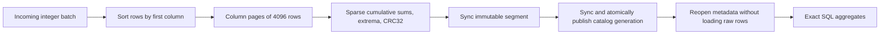

# Disk-backed analytics in KestrelSQL 0.3.8

**Latest checkpoint compression model:** [069 saves 62.8% of stored large-checkpoint bytes but fails paid-latency gates](COMPRESSION_069.md). All 36 cases and 432 frames are preserved. Large publication totals are 1.71x/1.89x raw; two goals, six guards and three A/A checks fail. Exact native/Python decoding and eight debug/release tests pass. Model rejected; no SQL engine edit or supported promotion. 0.3.16 remains supported.

**Latest publication diagnostics:** [068 identifies individual slow publication stages](TRACE_068.md). An opt-in one-slot tracer on the exact released core passes 80 debug/release tests and full correctness/recovery. All six diagnostic stores, six byte-equivalence stores and 32 group-kill stores are retained. No speedup or competitor comparison, overhead qualification, physical-cause claim or supported promotion. Supported 0.3.16 remains unchanged.

**Latest engine buffer trial:** [067 bounds reusable catalog memory](BUFFER_067.md). Large-history catalog encoding takes 17.1%/19.8% less time; six memory guards pass. All 54 native cases and all 32 validated group-kill stores are preserved. Failures: 1 speed goal, 4 latency guards, 11 identical-baseline checks. Full correctness and exact released/candidate archive bytes pass. No service advance or supported promotion; 0.3.16 remains supported.

**Latest encoder profiles:** [065/066 isolate catalog-buffer allocation](ENCODER_PROFILES_065_066.md). Separate twelve-round replication passes 43/43 checks and reduces fixed-input encoding time by 21.1%/22.8% on large checkpoints. Original calibration failure remains visible. These are CPU models; supported 0.3.16 and all database results remain unchanged.

**Latest compaction trial:** [064 increases bounded merge fan-in](COMPACTION_064.md). 5/6 native speed goals, 1/12 candidate guards and 5/18 identical-baseline checks fail. Correctness/recovery pass, including fourteen wider-merge cuts. No service advance or supported promotion; 0.3.16 and all earlier results remain unchanged.

**Latest batching experiment:** [063 tests current released 0/1/4 ms options with identical zero-delay controls](BATCHING_063.md). 4/10 identity checks and 6/26 option criteria fail. All previous native gains and service failures remain preserved. Supported 0.3.16 and its zero-delay default are unchanged.

**Latest service calibration:** [062 compares identical released binaries and unchanged clean core 061](SERVICE_CALIBRATION_062.md). 3/14 A/A tolerance checks fail; 2/14 candidate/A guards fail. Original 061 native gains, full DuckDB matrix and all ten service failures remain preserved. No engine change or supported promotion.

**Latest clean core development:** [061 ports the parser gain independently of SDK 058/060](CORE_READ_PATH_061.md). Native range medians 5.6 to 2.7 microseconds; 60/60 fresh DuckDB median wins, 0/60 failed native guards, 10/29 failed service guards. 77 tests per mode and full correctness/recovery gates pass. Supported 0.3.16 is unchanged.

**Latest read-path development:** [060 reproduces roughly 50% shorter native range queries and 28–29% shorter parsing](READ_PATH_060.md). 82 tests per mode, 4,000 SQL cases per reference, 42 fault/retry stores and 18 read-service cases pass. Network p99 has no consistent win; prior write-tail failures remain. Supported 0.3.16 is unchanged.

**Latest service qualification:** [059 retains SDK gains and rejects nine regression criteria](SERVICE_GUARDS_059.md). All 36 cold checks pass; three current minute runs have zero loss, while overload losses and slower tails remain. The disk stop, original 20 cases and resumed-only 16 cases are preserved. Supported 0.3.16 is unchanged.

**Latest SDK development trial:** [058 adds machine-readable ingestion outcomes](ERROR_CONTRACT_TRIAL_058.md). 82 debug/release tests, 42 fault/reopen cases and seven paired guards pass; slower samples and driver failures remain visible. No speed-up or supported engine release is claimed; 0.3.16 is unchanged.

**Latest storage model:** [057 rejects advance zero filling after charging initialization](PUBLICATION_057.md), with a verified standalone Cargo reproduction. [Adoption assessment](ADOPTION_STATUS.md) explains the current case for Kestrel alongside PostgreSQL. No SQL engine upgrade; supported 0.3.16 and every earlier result remain unchanged.

**Morning report, October 7:** [Bulgarian before/after, wins/losses, recovery and every failed trial](OVERNIGHT_2026-10-07.md). [056 tests a persistent-file primitive and fails two hypothesis checks](PUBLICATION_056.md); it changes no SQL engine. Supported 0.3.16 and all earlier releases remain unchanged.

**Latest CAT6 service qualification:** [055 preserves native gains but fails write-tail and zero-loss service gates](SERVICE_TRIAL_055.md). [054 keeps all ten native pairs and adds 88 debug passes](PUBLICATION_054.md). The disk-space failure and resumed-only missing tests remain visible; supported 0.3.16 is unchanged.

**Latest compact-receipt trial:** [053 halves checkpoint metadata and improves native tails, but fails the p50 guard](TRIAL_053.md). Full correctness/migration checks pass; all slower rounds and raw evidence remain visible. Supported 0.3.16 is unchanged.

**Latest native publication work:** [051 measured receipt-checkpoint stalls](PUBLICATION_051.md) and [052 file-sizing experiment rejected by all four gates](TRIAL_052.md). Raw results, slower rounds and failure evidence remain accessible; supported 0.3.16 is unchanged.

**Fresh isolated 050 service results:** [all 36 paired cases, wins/losses, raw samples and recovery audit](SERVICE_TRIAL_050.md). Supported 0.3.16 remains unchanged; older measurements and rejected trials remain visible.

**Verified development hardening 050:** [CAT5 restore identity fix, failing/passing regressions and full recovery checks](TRIAL_050.md). Supported 0.3.16 remains unchanged; fresh performance qualification is pending.

**Unreleased trial 049:** [retained-handle service measurements and recovery evidence](TRIAL_049.md). Supported 0.3.16 remains unchanged; all rounds, failures and raw data are preserved.

**Unreleased storage trial 048:** [paired service results, failed gates and full recovery evidence](TRIAL_048.md) test a single synchronized generation file. Supported 0.3.16 remains unchanged; all baseline, slower and failed trial evidence is preserved.

**Fresh post-release service qualification:** [SERVICE_047.md](SERVICE_047.md) retains 52 million-row cases and 1,327,600 offered operations on unchanged 0.3.16. In three current six-engine rounds, Kestrel had 3/5 mixed-p99 median wins, 4/5 read-p99 wins and 2/5 append-p99 wins. Its failed 60-second soak and inconsistent batching trials remain visible; these results establish no engine upgrade or production service guarantee.


The `Archive` path is an append-only SQL analytics store. It writes batches to immutable column segments and answers eligible aggregate queries with sparse indexes. Raw rows stay on disk. The original `Database` API is a separate implementation with transactional, RAM-resident tables; its old 10-million-row and full-prefix limits do not govern Archive.

Version 0.3 adds immutable snapshots, durable identified batches, bounded small-run compaction and a shared decoded-page cache. The concurrent embedded wrapper and replay contract are described in [LIVE_METRICS.md](LIVE_METRICS.md); original 0.3 evidence is in [V03_RESULTS.md](V03_RESULTS.md) and current read-query evidence is in [PERFORMANCE_038.md](PERFORMANCE_038.md).

The 0.3.9 grouping planner uses typed direct-address arrays for group-key spans of at most 65,536 slots under a conservative 8 MiB state budget. Above 4,096 slots, the span must also fit the archive row count. Wider domains use a standard randomized HashMap from keys to typed accumulator slots. SUM/AVG and repeated reductions share exact i128 sums. A 256-entry tagged cache checks complete keys and is released above 128 distinct keys or after a block of at least 64 selected rows with fewer than half hits; disabled blocks use a plain hash kernel. Both paths keep the 100,000-group result limit. Plans identify `streamed-dense-group` or `streamed-hash-group`. Persistent indexes and publication formats are unchanged. See [current measured wins/losses](PERFORMANCE_039.md).

The 0.3.10 streaming selection path builds positions directly from the first predicate remaining after sorted-column bounds. Later predicates retain those positions. It preserves all six comparisons, local block offsets, aggregate null/empty semantics, group limits and checksummed reads. This is query execution work; persistent indexes, formats and writer policy are unchanged. See [current controls and full matrix](PERFORMANCE_040.md).


## Reproduce

PowerShell, from this repository:

```powershell
cargo build --release --locked
python -m pip install -r benchmarks\requirements.txt
python benchmarks\archive_verify.py --binary target\release\kestrel.exe
python benchmarks\nyc_pipeline.py --binary target\release\kestrel.exe
python benchmarks\gold_verify.py
python benchmarks\large_scale.py --binary target\release\kestrel.exe
python benchmarks\random_windows.py --binary target\release\kestrel.exe
```

To regenerate the static charts, install `benchmarks\plot-requirements.txt` and run `python benchmarks\plot_results.py` after both scale reports exist.

The scale suite uses 10 million, 50 million, and 100 million ordered rows, followed by 100 million rows with 5% late timestamps. It persists every row. Kestrel payloads alone occupy about 6.24 GB, with additional space for DuckDB files and temporary datasets. Reference execution uses one thread and a 256 MB DuckDB buffer-manager limit. The latter is not a total-process memory cap; actual peak working sets are recorded separately. Published results come from a live Windows machine, with uncontrolled OS caches and other applications running. `gold_verify.py` checks the join, complete calendar spine, window functions, and daily reconciliation in `portfolio/gold_analysis.sql`; it locates the database through the NYC report unless `--database` is supplied.

To try a smaller example with the bundled Windows executable:

```powershell
.\bin\kestrel.exe --archive ..\..\work\new-demo --scale 1000000 7 --late
.\bin\kestrel.exe --archive ..\..\work\new-demo --sql "SELECT COUNT(*), SUM(value), AVG(value) FROM events WHERE ts >= 200317 AND ts < 700123"
```

`--scale` requires an empty archive. Normal queries reopen an existing archive. Default schema: `events(ts BIGINT, value BIGINT, device BIGINT)`, with non-null signed integers. Use `--columns` with comma-separated identifiers when importing another integer schema. On Linux, use the executable path without `.exe`; Linux CI is configured but was not executed during local qualification.

## Ingest and query

```rust
use kestrel_sql::archive::Archive;

fn main() -> Result<(), Box<dyn std::error::Error>> {
    let mut archive = Archive::open("event-archive", "events", &["ts", "value", "device"])?;
    // Batch order may be arbitrary. Rows retain their associations during sorting.
    archive.append(vec![vec![102, 100, 101], vec![25, 12, 18], vec![1, 1, 2]])?;
    let result = archive.query("SELECT COUNT(*), SUM(value) FROM events WHERE ts >= 100 AND ts < 102")?;
    assert!(result.bytes_read > 0);
    archive.verify()?; // Read every payload page and check its aggregate index.
    Ok(())
}
```

Each anonymous `append` publishes one atomic segment and repeating it repeats its events. `append_once(id, columns)` persists a SHA-256 payload identity and a receipt; exact retries return the original receipt without duplicating rows. `append_group` validates all members before publishing one combined segment and their receipts. It is an ingestion group, not a SQL transaction with UPDATE/DELETE. The original NYC portfolio pipeline still creates a fresh target per rebuild; the additional live pipeline demonstrates identified incremental retries.

`--import-i64 FILE` streams a headerless row-major file of little-endian signed 64-bit integers into segments. The caller supplies column order and schema. The importer checks complete-row alignment before ingesting, caps its batch size, then verifies all published blocks. The provenance sidecar records the exported file's SHA-256; this binary interface is an internal, explicitly typed interchange format, not a general data ingestion protocol.

Archive SQL supports COUNT(*), SUM, AVG, MIN, MAX, comparisons joined by AND, one GROUP BY column, ORDER BY an output name, and LIMIT. Projected columns must be the grouping key. Values are BIGINT, exact sums are i128, and averages are f64. Raw row projection, SELECT *, joins, nullable columns, SQL DDL, and transaction statements use other tools or remain unsupported in this API. Unsupported syntax fails explicitly.

Schema identifiers are unquoted ASCII and are normalized to lowercase; SQL lookup is case insensitive. Duplicate column names differing only in case are rejected.

## Data path



Segments contain at most one million rows. Every 4,096-row page has a checksum, endpoint, minimum, maximum, and cumulative aggregate checkpoint. Segment metadata also records column extrema and whether the column is nondecreasing. All schema names and segment references are validated on reopening.

For predicates on a sorted column, a binary search of page endpoints locates the boundary pages. A second binary search finds the exact boundary inside each page. Fully selected pages contribute stored totals and extrema; partially selected pages are read and checked. Segment extrema prune impossible runs, and fully selected runs use metadata alone. Independently sorted runs can overlap in time, so late arrivals preserve correctness and aggregate-index eligibility.

More general predicates and grouping stream selected column pages. A sorted time predicate bounds that scan even when additional filters are present. The current grouping matrix includes both wins and losses against DuckDB; broad scans and some hash workloads still lose, as shown in [PERFORMANCE_039.md](PERFORMANCE_039.md). Compression, larger sequential read units, vectorized execution, and better grouping structures are possible improvements that require profiling.

For `r` overlapping runs, a boundary aggregate costs approximately O(r × log(p) + boundary rows), where `p` is pages per run. Most irrelevant runs are pruned. Whole-run totals use metadata; partial MIN/MAX queries also inspect the extrema of fully covered pages. There is no query-result cache. Index maintenance, sorting, metadata storage, and persisted writes are part of ingestion cost.

## Memory and persistence limits

The 0.3.2 scan candidate reuses a query-local byte buffer and decoded column vectors across pages. It maintains a row selection of at most 4,096 positions and applies typed ungrouped aggregate kernels. These buffers are additional active-query memory, rather than entries in the shared 32 MiB boundary cache. Page CRC validation and independent long-scan handles remain in place. See [PERFORMANCE_032.md](PERFORMANCE_032.md) for gains and service failures.

Raw storage is 8 bytes per column per row, plus sparse metadata. Sparse index arrays use roughly 44 bytes per column per page, plus vector and segment overhead. The schema and data shape used in the scale test have three integer columns; wider tables and other distributions need independent qualification.

Internal guards limit batch payloads to 64 MiB, each segment to one million rows, schema width to 64 columns, index-array memory to 128 MiB, metadata envelopes to 64 MiB, and group results to 100,000 entries. These are allocation guards rather than an OS-enforced RSS limit. Caller-owned inputs, temporary serialization, allocator behavior, maliciously damaged metadata, and kernel file caches can add memory. The benchmark measures process peak working set rather than claiming a global machine-memory bound.

Every segment and catalog has a checksummed, versioned metadata envelope. Segments are synchronized before the new catalog is synchronized and renamed into place. A cooperating second opener fails on the held OS lock. Orphan segments and `.pending` catalogs are ignored; a later append uses a new generation rather than overwriting them. Published corrupt catalogs and referenced missing/corrupt metadata fail on reopening. An I/O error during publication reports an unknown outcome and poisons the handle.

Uncached read pages validate CRC32; boundary pages can then be reused from the 32 MiB retained decoded-page/prefix cache. Metadata-only aggregates do not reread all underlying payloads; `verify()` bypasses the cache, performs a full scrub and checks both data and derived indexes. A failed scrub clears the shared cache. CRC32 detects accidental damage and provides no adversarial authentication. External mutation of a live store is unsupported.

`compact_small()` replaces up to 32 small runs with one synchronized segment and catalog, preserving receipts. `reclaim()` removes superseded catalogs and retired payloads only when no snapshot pins those payloads. `LiveArchive` schedules this bounded maintenance automatically. Crash orphans and pending files are left for inspection; complete orphan cleanup and a retention policy remain operational work.

Version 0.3.1 buffers segment and catalog output and explicitly flushes those buffers before `sync_all()`. Exact replay-only groups validate existing receipts without copying the full ledger or publishing a new generation. New publications still copy and serialize committed receipts. Compaction reads checked input pages through retained immutable handles; long queries and full scrubs use independent handles. Publication-stage diagnostics and repeated performance evidence are in [PERFORMANCE_031.md](PERFORMANCE_031.md).

Tests cover interrupted publication, checksums, pinned snapshots, identified retries, compaction and independent result reconciliation. The historical [0.2 hard tests](HARD_TESTS.md) and [0.3 results](V03_RESULTS.md) retain separate evidence; the new forced-kill suite additionally replays identified batches after recovery. The separate RAM/WAL implementation has its own process-kill regression test.

Snapshots retain immutable committed generations while the single writer appends and compacts. They also retain the store's OS lock; this is in-process concurrency, not independent process readers. Version 0.3.3 reads `KSQLCAT2`/`KSQLCAT3`/`KSQLCAT4` and writes CAT4. This checkpointed catalog chain records only new receipts between full checkpoints, with a 32-file recovery ceiling. New appends and compactions no longer copy the committed ledger. Recovery validates every dependency, and reclaim retains the current chain. Older binaries reject CAT4; the first successful write upgrades the store, with no downgrade converter. Segment payloads remain `KSQLSEG2`. See [PERFORMANCE_033.md](PERFORMANCE_033.md).

Physical power loss, Windows directory-entry durability, online schema migration, long endurance testing and a stable future on-disk compatibility contract remain unqualified. The loopback JSON bridge is test-only and uses `LiveArchive` snapshots and group commits. Production certification is incomplete.

The 0.3.11 seeded cache uses the upper bits of a wrapping multiply with an odd multiplier drawn once per query from the existing HashMap random state. Exact signed tags resolve hits; the authoritative randomized map resolves misses. The 256-slot/128-key bounds and low-hit-rate fallback remain. Random seeds and crafted collisions do not guarantee low latency; persistent formats and writer policy are unchanged. See [current pairs and all losses](PERFORMANCE_041.md).

The 0.3.12 medium cache is a query-local 16,384-slot exact-tag table. After the small cache is abandoned, at least 50% repeated keys in a block of at least 64 selected rows and at most 8,192 keys enable one promotion attempt. Allocation waits for a later nonempty block; crossing the key budget or dropping below 50% hits releases the table. Its additional memory is 384 KiB on this 64-bit computer. The randomized HashMap and exact i128 state remain authoritative; formats and writer policy are unchanged. [Measurements, guards and losses](PERFORMANCE_042.md).

The 0.3.13 dense reduction validates each selected key, counts the row and updates an exact i128 sum in one pass when SUM/AVG projections share a single column and no MIN/MAX reduction is needed. Repeated SUM/AVG outputs share state. The intermediate slot vector retains its reserved capacity but is not filled or revisited in this case. Mixed reducers, sparse mapping, budgets, readers, writers, formats and source checkpoints are unchanged. [Profiles, controls and correctness](PERFORMANCE_043.md).

The 0.3.14 sparse kernel writes a tagged cache entry only on a miss. A block entered with the small cache active can fuse exact counts and a single shared SUM/AVG column into key lookup; the block finishes this kernel before cache growth or collision fallback changes the next block. Larger and plain-hash modes keep the preceding two-pass mapper. A typed sum vector is restored even when mapping returns a group-budget error. Existing cache budgets, seeded tags, HashMap authority, reserved intermediate capacity and storage/writer/source policy remain. [Trials, guards and correctness](PERFORMANCE_044.md).

The 0.3.15 reader reuse cache retains one owned idle File per segment, capped at 128 idle files across current and pinned retired segments. Taking a cached file removes it from the idle slot and budget; a query exclusively owns its seek/read cursor. Concurrent misses open independent files. Active query handles are additional and admission is unchanged. Query-local Reader drop returns a file when a slot and budget are available; segment drop closes retained files and releases the budget. No File::try_clone cursor sharing or extra snapshot references are introduced. Payload reads still validate CRCs; I/O/checksum errors discard the active file and clear that segment slot. Full scrubs open fresh files and clear page/idle caches after failure. ArchiveStats exposes process-local retained_stream_handles, stream_handle_opens and stream_handle_reuses; all reset on reopen. [Trials, resource lifetime and correctness](PERFORMANCE_045.md).

The 0.3.16 promoted sparse group cache stores exact signed i64 keys with a checked u32 slot-plus-one field. Zero slot fields are empty regardless of key bits; zero and signed boundary keys remain valid. The table retains 16,384 entries and the 8,192-key ceiling, but its payload falls from 384 to 256 KiB on this 64-bit build. Deferred allocation, learning/fallback and exact wide reductions remain. Reader ownership, retirement and durable formats/source/writer policy retain preceding source identity. [Memory, criteria and correctness](PERFORMANCE_046.md).
