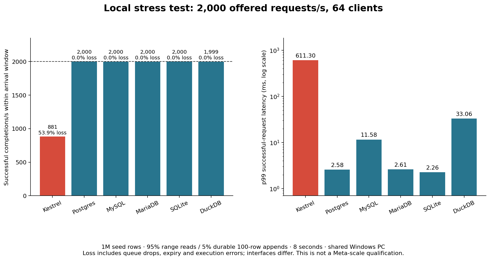
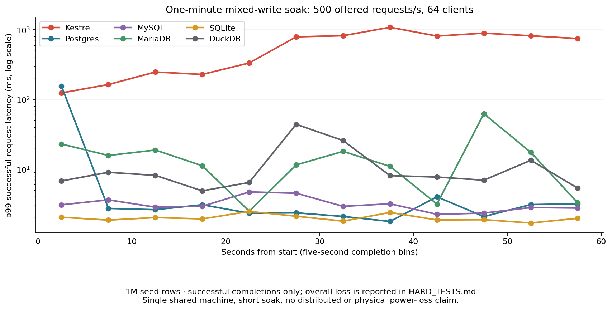

# KestrelSQL: local concurrency and failure qualification

**Kestrel does not meet the tested mixed-write performance target and is not production qualified.** At 2,000 offered requests/s with 64 clients it completed 881.12/s during the arrival window, with 611.30 ms p99 among successful requests and 53.94% unsuccessful or unexecuted requests. Several reference engines sustained this offered rate with no request loss. The earlier 100M-row aggregate advantage is specific to indexed range analytics; it does not establish fast transactional service performance.

This is an executed comparison on one Windows computer, as requested. **66 cases, 933,600 offered requests, up to 64 clients**, six database engines, 1M initial rows per fresh case, plus actual process-kill and integrity tests. SQL clients are interfaces to engines; this report compares the six engines through the interfaces below. It cannot cover every SQL product.

## Results: 2,000 requests/s mixed workload

95% range COUNT/SUM queries, 5% append operations, 100 rows per durable append, 8-second arrival window. These are request rates, not inserted-row rates. A read or a whole append batch is one request.

| Engine | Successful requests/s during arrival window | p99 success latency, ms | Unsuccessful / unexecuted | Acknowledged 100-row batches |
|---|---:|---:|---:|---:|
| KestrelSQL Archive | 881.12 | 611.30 | 8,631 (53.94%) | 365 |
| PostgreSQL | 2,000.00 | 2.58 | 0 (0.00%) | 803 |
| MySQL | 1,999.88 | 11.58 | 0 (0.00%) | 803 |
| MariaDB | 1,999.88 | 2.61 | 0 (0.00%) | 803 |
| SQLite | 2,000.00 | 2.26 | 0 (0.00%) | 803 |
| DuckDB | 1,998.75 | 33.06 | 0 (0.00%) | 803 |



Loss is part of the result. A low percentile after dropping work is not evidence of a faster service. Completion rate counts only successful requests finished inside the scheduled arrival window; successful requests during draining are separately recorded in the raw report. p99 includes successful operations from the window and drain, and excludes failed, dropped, and expired requests.

## One-minute mixed-write soak

500 offered requests/s, 64 clients, 60 seconds; same 95/5 mixture. This is a short soak, not a long-duration endurance qualification.

| Engine | Successful requests/s during arrival window | p99 success latency, ms | Unsuccessful / unexecuted | Acknowledged 100-row batches |
|---|---:|---:|---:|---:|
| KestrelSQL Archive | 475.17 | 963.76 | 1,259 (4.20%) | 1,409 |
| PostgreSQL | 500.00 | 3.49 | 0 (0.00%) | 1,483 |
| MySQL | 500.00 | 3.21 | 0 (0.00%) | 1,483 |
| MariaDB | 500.00 | 17.14 | 0 (0.00%) | 1,483 |
| SQLite | 500.00 | 1.95 | 0 (0.00%) | 1,483 |
| DuckDB | 499.98 | 9.22 | 0 (0.00%) | 1,483 |



Kestrel's 64-client read-only case at 500 offered requests/s lost no requests. Its one-minute mixed-write case degraded despite the lower arrival rate. The Archive publication path synchronizes a segment and catalog per batch, rewrites catalog metadata, and accumulates files. The test bridge holds an exclusive write lock across append. These are plausible contributors to stalls; this run does not include profiling that isolates their individual costs.

## Overload burst

10,000 offered requests/s, 64 clients, 8 seconds. The generator, drivers, OS scheduling and database share one machine, so these are whole-path overload observations rather than maximum engine capacities.

| Engine | Successful requests/s during arrival window | p99 success latency, ms | Unsuccessful / unexecuted | Acknowledged 100-row batches |
|---|---:|---:|---:|---:|
| KestrelSQL Archive | 1,448.00 | 413.77 | 68,076 (85.09%) | 582 |
| PostgreSQL | 6,673.25 | 82.80 | 26,293 (32.87%) | 2,756 |
| MySQL | 4,346.88 | 118.45 | 44,900 (56.12%) | 1,770 |
| MariaDB | 5,234.12 | 83.97 | 37,805 (47.26%) | 2,154 |
| SQLite | 9,054.75 | 82.98 | 7,490 (9.36%) | 3,664 |
| DuckDB | 2,970.50 | 157.89 | 55,916 (69.89%) | 1,266 |

## Workload and measurement contract

- Tested versions: KestrelSQL Archive 0.2.0, PostgreSQL 17.6, MySQL 8.4.11, MariaDB 11.8.9-MariaDB, SQLite 3.49.1, DuckDB v1.5.6. Python 3.12.10; 20 logical CPU threads and about 31.9 GiB physical RAM; Windows 10 build 19045. The desktop and OS caches were not isolated. Each query uses one execution thread; concurrent clients can execute together. No CPU affinity, cold-cache control, independent load host or repeated-run confidence intervals.
- Every case starts with a fresh three-column integer table: `ts`, `value`, `device`. Values follow a deterministic generator with seed 20261006. 80% of range reads target a 1% timestamp hotspot, with 100- or 1,000-row-width intervals. Appends contain 100 rows, 5% with late timestamps. This hotspot is read concentration, not contention on repeatedly updated social-graph rows.
- Per engine: read and 5% append profiles at 1/16/64 clients and 500 requests/s; 25% append profile at 64 clients and 500/s; scan/grouping profile with 10% appends at 64 clients and 200/s; 5% append at 2,000/s and 10,000/s; then the 60-second 500/s soak. Other sweeps last 8 seconds. Scan queries include full grouping and a filter on unsorted `value`.
- Open-loop arrivals are scheduled independently of completions. Latency starts at the scheduled arrival and includes dispatch lag, client queueing and execution. The queue holds 256 requests. A request older than two seconds when dequeued expires without execution. Queue-full drops, expiry, execution errors and ambiguous commits are recorded separately. Each request has an eight-second connection/statement or socket timeout where supported; native SQLite uses a five-second busy timeout. Native DuckDB has no harness-enforced statement cancellation. Setup uses 120 seconds and is outside timing.
- Kestrel uses one shared `Archive` behind a Rust `RwLock` and a loopback JSON bridge. Queries acquire shared locks; append acquires an exclusive lock. The bridge is a bounded-message benchmark helper, not a production service. It has no authentication, session transaction contract, connection admission limit or query cancellation. Independent Archive processes cannot read while another holds the store lock.
- PostgreSQL, MySQL and MariaDB use native loopback protocols; SQLite and DuckDB use Python bindings. The Python generator and drivers can impose their own limits, especially at 10,000/s. Dispatch-lag percentiles and full per-request timings are retained; differences in interface and serialization cost prevent a universal engine ranking.
- PostgreSQL gets a `ts INCLUDE(value)` covering index; MySQL/MariaDB/SQLite get `(ts,value)` covering indexes. Kestrel uses its aggregate checkpoints; DuckDB its normal storage/zonemaps. PostgreSQL buffers and InnoDB buffers are 128 MiB; DuckDB uses a 256 MB buffer-manager limit. These settings are not equal total-memory caps. No derived aggregate views were added to the references.
- Durable acknowledgments use Kestrel synchronized segment/catalog publication, SQLite WAL with `synchronous=FULL`, PostgreSQL `synchronous_commit=on`, MySQL/MariaDB `innodb_flush_log_at_trx_commit=1` with binary logging disabled, and DuckDB file-backed autocommit. This tests local commit behavior, not replicated durability or physical power loss. SQLite's WAL permits reader/writer concurrency but only one writer; FULL adds synchronization on commits. [SQLite WAL documentation](https://www.sqlite.org/wal.html)

15 initial provisioning attempts failed because the original eight-second request timeout was also used for bulk seed loading. Missing cases were rerun with a separate 120-second setup timeout. The initial errors remain in `failed_cases`, marked resolved; their failed setup time is excluded from load results. The raw report combines the completed first-pass and missing-case rerun results. There was no performance rerun chosen to replace a slower result.

## Correctness and failure results

Every completed stress case reopens Kestrel or uses fresh native reference connections, reconciles all seed rows and every batch against independent expected counts/sums, and checks 20 NumPy reference windows after concurrent late writes. All acknowledged batches remained present; published batches were complete and had correct sums. Unacknowledged-but-committed batches are reported explicitly, rather than assuming a timeout means rollback. All 11 Kestrel cases also passed a complete payload scrub. This is post-run reconciliation; it does not verify every live query's snapshot against an online oracle.

The sample audit checked 675,940 executed request samples, success/loss accounting, unique sequence identifiers, and the published percentiles. Across six engines there were 675,906 successes and 257,694 unsuccessful/unexecuted offers. 1,320 independent reference windows matched.

24 forced OS process kills interrupted active Archive ingestion at delays from 2 ms to 500 ms. After reopening, every acknowledged batch survived, published batches were whole, exact prefix counts/sums matched, and full scrubs passed. A committed batch whose acknowledgment was lost may still appear, so this is not an exactly-once retry guarantee. The OS and disk remained running: no physical power-loss, disk-full, filesystem write-failure or replicated failover qualification is claimed.

Boundary checks rejected 1,007 malformed/unsupported SQL statements without data changes, rejected an independent store opener, and explicitly failed the group-materialization guard with a healthy store afterward. A flipped payload byte was rejected when its page was read and by the full scrub. Metadata-only totals still succeeded, as designed; they do not scrub all payload pages.

## SQL capability checks

Executed against fresh 1,000-row fixtures. This matrix applies to the `Archive` path used for all new stress cases. The original RAM `Database` has a separate, limited transaction API.

| Executed check | Kestrel Archive | PostgreSQL / MySQL / MariaDB / SQLite / DuckDB |
|---|---|---|
| Exact range COUNT/SUM | Pass | Pass on all five |
| Raw row point projection | Unsupported | Pass on all five |
| Self join | Unsupported | Pass on all five |
| String and nullable schema | Unsupported | Pass on all five |
| SQL INSERT | Unsupported; append API used for load | Pass on all five |
| UPDATE / DELETE in a transaction, then verified rollback | Unsupported | Pass on all five |
| Independent Archive process reader while bridge is open | Rejected by store lock | Native connection concurrency checked; SQLite/DuckDB used two connections in one process |

The machine had no usable Docker/Linux test environment for ClickHouse and no local SQL Server or Oracle instance. CockroachDB, TiDB, YugabyteDB and Spanner distributed tests were not executed. These omissions are recorded in [capability-results.json](benchmarks/capability-results.json); no invented numbers or parity claims are supplied.

## What a Facebook-level test would require

Meta's published transactional TAOBench models social-graph access, contention and skew, with substantially more application behavior than aggregate event reads and appends. Our narrow common workload does not implement that benchmark or its operating scale. [Meta TAOBench article](https://engineering.fb.com/2022/09/07/core-infra/taobench/)

The separate DCPerf TaoBench package is a TAO-cache workload, with Linux and multi-host/network recommendations; it is not the transactional TAOBench implementation. [DCPerf package instructions](https://github.com/facebookresearch/DCPerf/blob/main/packages/tao_bench/README.md)

Before a credible transactional social-graph comparison, Kestrel needs point retrieval, typed objects and associations, mutation/transaction semantics, concurrent snapshots, retry identifiers and operational instrumentation. A production gate also needs compaction, retention, backup/restore, long endurance runs, disk faults and supported-platform qualification. Distributed Meta-scale validation further requires machines and an independent load fleet. This computer-only result establishes none of those qualifications.

For the next local iteration, use a project acceptance target of **2,000 offered mixed requests/s, zero loss and p99 at or below 100 ms**, with correctness reconciliation. This is our proposed target, not Meta's SLO. Preserve these results as the baseline, profile publication and locking, then evaluate batching/compaction and snapshot concurrency without weakening commit behavior.

## Reproduce on Windows x64

From this repository, with Python 3.12 and Rust 1.89+:

```powershell
python -m pip install -r benchmarks\stress_requirements.txt
cargo build --release --locked --bin kestrel-stress
python benchmarks\portable_servers.py start
try {
    python benchmarks\stress_compare.py --binary target\release\kestrel-stress.exe
    python benchmarks\hard_recovery.py --binary target\release\kestrel-stress.exe --sql-binary bin\kestrel.exe
    python benchmarks\capability_probe.py --binary target\release\kestrel-stress.exe --sql-binary bin\kestrel.exe
} finally {
    python benchmarks\portable_servers.py stop
}
python -m pip install -r benchmarks\plot-requirements.txt
python benchmarks\report_stress.py --plot
```

The bundled `bin/kestrel-stress.exe` can replace a local build. The portable helper downloads pinned official PostgreSQL/MySQL/MariaDB archives, verifies SHA-256, starts only loopback listeners with task-local data directories, and registers no Windows service. Its stop command verifies the server's data directory before requesting shutdown. Do not expose these password-free benchmark servers to a network. Allow approximately 0.7 GB for downloads and several GB for extraction/data/logs; the suite deletes its own completed case fixtures after reconciliation. Raw scale datasets and reference-server packages are omitted from the release ZIP. Fresh runs overwrite the result files; preserve the baseline copy before rerunning. `--resume` retries missing matrix cases and retains failures.

Evidence: [stress results](benchmarks/stress-results.json), per-request gzip files under `benchmarks/stress-samples/`, [sample audit](benchmarks/stress-audit.json), [forced kills and boundaries](benchmarks/hard-recovery-results.json), [capability checks](benchmarks/capability-results.json), [package provenance](benchmarks/reference-packages.json). The separate [100M analytics tests](SCALE.md) and [real-data pipeline](PORTFOLIO.md) provide complementary data-engineering evidence.

## Full executed matrix

| Engine | Profile | Clients | Offered/s | Duration, s | Success/s in window | p99 ms | Loss / unexecuted |
|---|---|---:|---:|---:|---:|---:|---:|
| KestrelSQL Archive | read | 1 | 500 | 8 | 500.00 | 1.77 | 0 |
| KestrelSQL Archive | read | 16 | 500 | 8 | 500.00 | 1.76 | 0 |
| KestrelSQL Archive | read | 64 | 500 | 8 | 500.00 | 1.77 | 0 |
| KestrelSQL Archive | mixed | 1 | 500 | 8 | 270.62 | 1,630.34 | 1,578 |
| KestrelSQL Archive | mixed | 16 | 500 | 8 | 496.00 | 125.05 | 0 |
| KestrelSQL Archive | mixed | 64 | 500 | 8 | 499.12 | 154.20 | 0 |
| KestrelSQL Archive | mixed | 64 | 2,000 | 8 | 881.12 | 611.30 | 8,631 |
| KestrelSQL Archive | mixed | 64 | 10,000 | 8 | 1,448.00 | 413.77 | 68,076 |
| KestrelSQL Archive | mixed | 64 | 500 | 60 | 475.17 | 963.76 | 1,259 |
| KestrelSQL Archive | write | 64 | 500 | 8 | 335.00 | 1,753.15 | 1,000 |
| KestrelSQL Archive | scan | 64 | 200 | 8 | 199.12 | 1,174.01 | 0 |
| PostgreSQL | read | 1 | 500 | 8 | 500.00 | 1.61 | 0 |
| PostgreSQL | read | 16 | 500 | 8 | 500.00 | 1.73 | 0 |
| PostgreSQL | read | 64 | 500 | 8 | 500.00 | 2.51 | 0 |
| PostgreSQL | mixed | 1 | 500 | 8 | 500.00 | 52.59 | 0 |
| PostgreSQL | mixed | 16 | 500 | 8 | 500.00 | 1.98 | 0 |
| PostgreSQL | mixed | 64 | 500 | 8 | 500.00 | 2.92 | 0 |
| PostgreSQL | mixed | 64 | 2,000 | 8 | 2,000.00 | 2.58 | 0 |
| PostgreSQL | mixed | 64 | 10,000 | 8 | 6,673.25 | 82.80 | 26,293 |
| PostgreSQL | mixed | 64 | 500 | 60 | 500.00 | 3.49 | 0 |
| PostgreSQL | write | 64 | 500 | 8 | 500.00 | 32.98 | 0 |
| PostgreSQL | scan | 64 | 200 | 8 | 99.00 | 5,067.39 | 537 |
| MySQL | read | 1 | 500 | 8 | 500.00 | 2.02 | 0 |
| MySQL | read | 16 | 500 | 8 | 500.00 | 2.88 | 0 |
| MySQL | read | 64 | 500 | 8 | 500.00 | 3.00 | 0 |
| MySQL | mixed | 1 | 500 | 8 | 500.00 | 60.62 | 0 |
| MySQL | mixed | 16 | 500 | 8 | 500.00 | 3.59 | 0 |
| MySQL | mixed | 64 | 500 | 8 | 500.00 | 4.02 | 0 |
| MySQL | mixed | 64 | 2,000 | 8 | 1,999.88 | 11.58 | 0 |
| MySQL | mixed | 64 | 10,000 | 8 | 4,346.88 | 118.45 | 44,900 |
| MySQL | mixed | 64 | 500 | 60 | 500.00 | 3.21 | 0 |
| MySQL | write | 64 | 500 | 8 | 500.00 | 24.05 | 0 |
| MySQL | scan | 64 | 200 | 8 | 29.00 | 7,740.96 | 1,243 |
| MariaDB | read | 1 | 500 | 8 | 500.00 | 1.48 | 0 |
| MariaDB | read | 16 | 500 | 8 | 500.00 | 1.72 | 0 |
| MariaDB | read | 64 | 500 | 8 | 500.00 | 1.53 | 0 |
| MariaDB | mixed | 1 | 500 | 8 | 500.00 | 24.71 | 0 |
| MariaDB | mixed | 16 | 500 | 8 | 500.00 | 2.83 | 0 |
| MariaDB | mixed | 64 | 500 | 8 | 500.00 | 2.63 | 0 |
| MariaDB | mixed | 64 | 2,000 | 8 | 1,999.88 | 2.61 | 0 |
| MariaDB | mixed | 64 | 10,000 | 8 | 5,234.12 | 83.97 | 37,805 |
| MariaDB | mixed | 64 | 500 | 60 | 500.00 | 17.14 | 0 |
| MariaDB | write | 64 | 500 | 8 | 500.00 | 3.24 | 0 |
| MariaDB | scan | 64 | 200 | 8 | 39.62 | 6,378.38 | 1,143 |
| SQLite | read | 1 | 500 | 8 | 500.00 | 1.16 | 0 |
| SQLite | read | 16 | 500 | 8 | 500.00 | 1.22 | 0 |
| SQLite | read | 64 | 500 | 8 | 500.00 | 2.12 | 0 |
| SQLite | mixed | 1 | 500 | 8 | 500.00 | 69.48 | 0 |
| SQLite | mixed | 16 | 500 | 8 | 500.00 | 1.81 | 0 |
| SQLite | mixed | 64 | 500 | 8 | 500.00 | 1.94 | 0 |
| SQLite | mixed | 64 | 2,000 | 8 | 2,000.00 | 2.26 | 0 |
| SQLite | mixed | 64 | 10,000 | 8 | 9,054.75 | 82.98 | 7,490 |
| SQLite | mixed | 64 | 500 | 60 | 500.00 | 1.95 | 0 |
| SQLite | write | 64 | 500 | 8 | 499.75 | 41.34 | 0 |
| SQLite | scan | 64 | 200 | 8 | 71.62 | 4,752.62 | 810 |
| DuckDB | read | 1 | 500 | 8 | 500.00 | 2.16 | 0 |
| DuckDB | read | 16 | 500 | 8 | 500.00 | 2.00 | 0 |
| DuckDB | read | 64 | 500 | 8 | 500.00 | 2.02 | 0 |
| DuckDB | mixed | 1 | 500 | 8 | 500.00 | 4.96 | 0 |
| DuckDB | mixed | 16 | 500 | 8 | 499.88 | 5.44 | 0 |
| DuckDB | mixed | 64 | 500 | 8 | 500.00 | 11.93 | 0 |
| DuckDB | mixed | 64 | 2,000 | 8 | 1,998.75 | 33.06 | 0 |
| DuckDB | mixed | 64 | 10,000 | 8 | 2,970.50 | 157.89 | 55,916 |
| DuckDB | mixed | 64 | 500 | 60 | 499.98 | 9.22 | 0 |
| DuckDB | write | 64 | 500 | 8 | 373.12 | 2,650.68 | 1,013 |
| DuckDB | scan | 64 | 200 | 8 | 199.88 | 19.48 | 0 |
