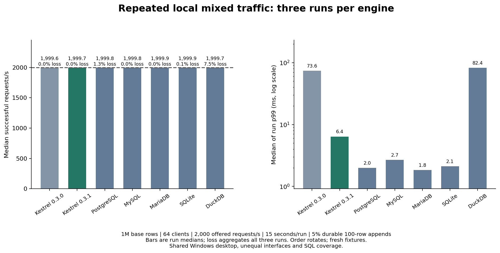
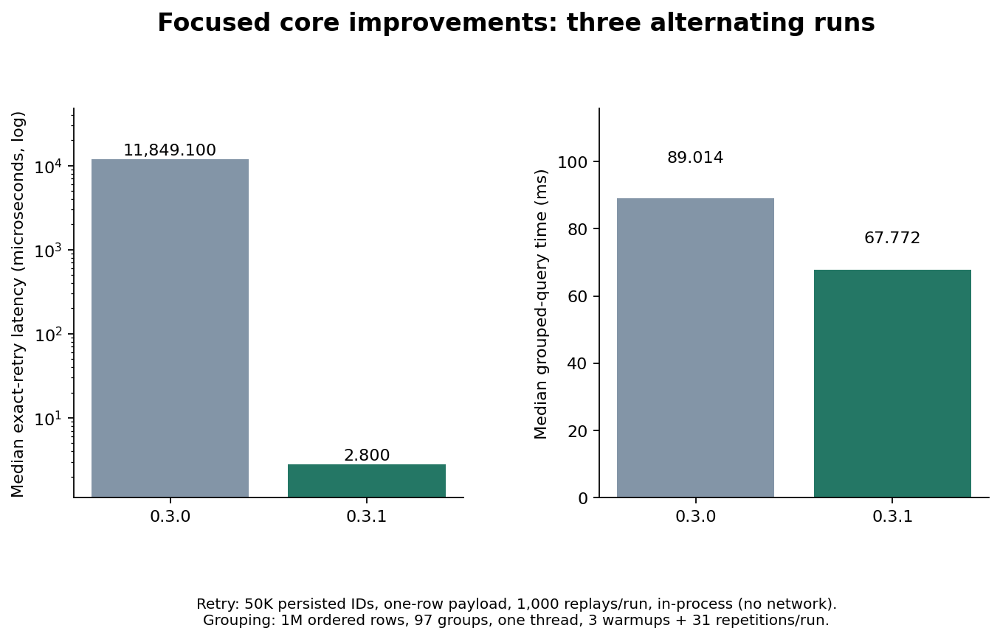

# KestrelSQL 0.3.1: measured improvements and repeated comparisons

This performance release removes full-ledger copying from exact retries, reuses retained segment handles during compaction, buffers small publication writes, avoids an extra GROUP BY hash lookup, and adds publication-stage diagnostics. It preserves the 0.3 catalog/segment format and durable acknowledgment contract. It remains an experimental embedded BIGINT aggregate store.

The repeated 2,000/s mixed comparison changed median run p99 from 73.64 to 6.38 ms. The candidate completed all offers in 3/3 runs with p99 below 100 ms. The standalone 10,000/s case still lost 25,367 offers; single-client mixed p99 remained 147.72 ms. The direct unordered-filter probe also regressed. These boundaries remain visible alongside improvements.

## Repeated mixed traffic: six database engines, two Kestrel builds

Three runs per build/engine, each with a fresh 1M-row fixture, 64 clients, 2,000 offered requests/s for 15 seconds, 95% range reads and 5% durable 100-row appends. Five percent of appended timestamps are late. Engine order rotates by two positions per round. Medians and ranges below describe separate run statistics; they are not pooled percentiles or confidence intervals. Loss counts include errors, expiry and unexecuted offers.

| Build / engine | Median successful requests/s | Median run p99, ms | Run p99 range, ms | Unsuccessful / offered | 100 ms, zero-loss passes |
|---|---:|---:|---:|---:|---:|
| Kestrel 0.3.0 | 1,999.60 | 73.64 | 54.15 - 117.86 | 0 / 90,000 | 2 / 3 |
| Kestrel 0.3.1 | 1,999.73 | 6.38 | 4.24 - 31.17 | 0 / 90,000 | 3 / 3 |
| PostgreSQL | 1,999.80 | 1.98 | 1.72 - 620.31 | 1,136 / 90,000 | 2 / 3 |
| MySQL | 1,999.80 | 2.67 | 2.48 - 2.78 | 0 / 90,000 | 3 / 3 |
| MariaDB | 1,999.93 | 1.83 | 1.76 - 59.39 | 0 / 90,000 | 3 / 3 |
| SQLite | 1,999.87 | 2.11 | 1.83 - 142.39 | 133 / 90,000 | 2 / 3 |
| DuckDB | 1,999.73 | 82.40 | 51.77 - 602.43 | 6,708 / 90,000 | 2 / 3 |



## Generic scans

Three eight-second cases per variant at 200 offered requests/s. The common scan profile includes full grouping, unordered filters, range reads and 10% durable appends. All results are retained, including saturation of less suitable engines.

| Build / engine | Median successful requests/s | Median run p99, ms | Run p99 range, ms | Unsuccessful / offered | 100 ms, zero-loss passes |
|---|---:|---:|---:|---:|---:|
| Kestrel 0.3.0 | 199.62 | 78.01 | 71.56 - 81.32 | 0 / 4,800 | 3 / 3 |
| Kestrel 0.3.1 | 199.88 | 47.60 | 47.24 - 49.74 | 0 / 4,800 | 3 / 3 |
| PostgreSQL | 104.88 | 4712.71 | 4652.65 - 5195.93 | 1,453 / 4,800 | 0 / 3 |
| MySQL | 33.50 | 8019.92 | 7442.78 - 8256.38 | 3,569 / 4,800 | 0 / 3 |
| MariaDB | 43.50 | 5658.66 | 5612.14 - 6098.29 | 3,260 / 4,800 | 0 / 3 |
| SQLite | 86.25 | 4498.81 | 4402.95 - 5114.69 | 1,909 / 4,800 | 0 / 3 |
| DuckDB | 200.00 | 137.51 | 66.53 - 334.52 | 0 / 4,800 | 1 / 3 |

## Broad windows at 10M rows

Three 15-second cases per build/engine, 64 clients, 2,000 offered requests/s. Random windows cover 25-50% of the base rows, with 5% durable append batches. Kestrel maintains exact aggregate checkpoints; DuckDB uses normal raw aggregate execution and zonemaps. Maintenance, storage and interfaces differ; this is not an equivalent-materialized-view comparison.

| Build / engine | Median successful requests/s | Median run p99, ms | Run p99 range, ms | Unsuccessful / offered | 100 ms, zero-loss passes |
|---|---:|---:|---:|---:|---:|
| Kestrel 0.3.0 | 1,999.80 | 79.79 | 66.86 - 82.79 | 0 / 90,000 | 3 / 3 |
| Kestrel 0.3.1 | 1,999.80 | 4.42 | 4.35 - 38.70 | 0 / 90,000 | 3 / 3 |
| DuckDB | 677.67 | 584.73 | 569.99 - 603.63 | 58,512 / 90,000 | 0 / 3 |

## Exact retries with a large receipt ledger

Three alternating release-build runs per version: 50,000 persisted IDs, 1,000 exact one-row replays per run. Timings include caller allocation, payload hashing, lookup and validation within the Rust process. Setup, network, source reading and final scrub are excluded. Every run checks original generation, unchanged disk size, exact count/sum and every payload checksum. These numbers do not describe network request throughput.

| Build | Median of run medians, microseconds | Run p99 range, microseconds |
|---|---:|---:|
| Kestrel 0.3.0 | 11849.100 | 19718.400 - 29027.400 |
| Kestrel 0.3.1 | 2.800 | 4.600 - 11.900 |

## Direct query costs

Three alternating runs per version, 1M ordered rows, one execution thread, three warmups and 31 repetitions per fixed query. Every result matches across builds and every archive passes a full scrub. Repeated fixed-query timings characterize this fixture; randomized/concurrent traffic is tested separately above.

| Query | 0.3.0 median of run medians, ms | 0.3.1 median of run medians, ms |
|---|---:|---:|
| all_aggregates | 0.0106 | 0.0099 |
| broad_window | 0.0126 | 0.0125 |
| narrow_window | 0.0102 | 0.0101 |
| unordered_filter | 16.6879 | 20.7960 |
| grouped | 89.0142 | 67.7716 |
| min_max | 0.0187 | 0.0178 |

Grouping improved from 89.01 to 67.77 ms by median of run medians. The unordered-filter probe regressed from 16.69 to 20.80 ms. The filter operator did not change directly; these observations do not isolate code generation or host variation as a cause. Further profiling must address the regression before claiming a generic scan improvement.



## Why the next change targeted compaction

The buffered-write trial exposed five compactions with preparation stages over 100 ms in the single-client mixed case; ordinary append preparation stayed under 0.1 ms. The preparation stage includes compaction input reads and sorting. The final change reuses each immutable input segment handle for checked positional reads, eliminating path reopen work per compaction input. Long concurrent query scans still use independent handles. The table is an observation across separate runs, not an isolated causal estimate.

| Stage / single-client mixed case | Compactions | Total compaction time, ms | Average per compaction, ms | Run p99, ms |
|---|---:|---:|---:|---:|
| 0.3.0 fresh baseline | 5 | 1093.62 | 218.72 | 411.15 |
| 0.3.1 buffered trial | 5 | 1585.87 | 317.17 | 357.47 |
| 0.3.1 retained compaction handles | 5 | 108.39 | 21.68 | 147.72 |

Publication diagnostics split preparation, segment writing, segment synchronization, catalog encoding, catalog writing, catalog synchronization and rename. Inclusive histogram boundaries are 0.1, 1, 5, 20, 100, 500 and 1,000 ms, followed by an unbounded bucket. Counts/totals/histograms are differenced against pre-load state; lifetime maxima include fixture setup. Diagnostics are process-local and shared across snapshots, not durable data at the snapshot generation. Failed I/O attempts can have unexecuted stages represented by zero duration.

## Complete final local sweep

| Profile | Clients | Offered/s | Seconds | Success/s | p99 success, ms | Unsuccessful |
|---|---:|---:|---:|---:|---:|---:|
| read | 1 | 500 | 8 | 500.00 | 18.52 | 0 |
| read | 16 | 500 | 8 | 500.00 | 2.72 | 0 |
| read | 64 | 500 | 8 | 500.00 | 2.40 | 0 |
| mixed | 1 | 500 | 8 | 494.75 | 147.72 | 0 |
| mixed | 16 | 500 | 8 | 499.88 | 5.41 | 0 |
| mixed | 64 | 500 | 8 | 499.88 | 5.78 | 0 |
| write | 64 | 500 | 8 | 499.75 | 41.09 | 0 |
| scan | 64 | 200 | 8 | 199.25 | 99.37 | 0 |
| mixed | 64 | 2000 | 8 | 1999.75 | 6.31 | 0 |
| mixed | 64 | 10000 | 8 | 6789.12 | 86.11 | 25367 |
| mixed | 64 | 500 | 60 | 500.00 | 4.87 | 0 |

A request means one query or an entire 100-row append. Latency starts at scheduled arrival and includes dispatch, client queue and service. p99 includes successful requests only, including drain completions. Throughput counts successes completed during the arrival window. The client queue has 256 slots, two-second expiry and eight-second connection/statement deadlines.

## Verification and reproducibility

- 31 Rust tests passed in debug and release; formatting and Clippy with warnings as errors passed. The new capacity test commits 100,000 IDs, rejects an additional ID, reopens, replays old IDs and checks exact data and full checksums.
- 24 forced process-kill cycles passed acknowledged-write recovery, atomicity, full scrub and identified replay checks. Process death is not a power-loss qualification.
- The Parquet replay/backfill demonstration passed 42 exact DuckDB SQL checks; both sources replayed without new rows and changed content was rejected. An untimed recheck matched 153 retained scale/real-data results, including 100M ordered and late-data archives. The 64-column import boundary, partial-row rejection, legacy catalog read and old-binary downgrade rejection also passed.
- The audit checked 1,232,346 raw executed samples from 84 new stress cases and 1,400,400 offered requests, plus 6,000 replay timings and 1,116 direct query timings. All acknowledged batches and independent NumPy windows reconciled.
- A shared-target Cargo output collision produced an invalid probe comparison. Both executables reported 0.3.0; all six cases are retained and explicitly excluded. The replacement candidate probe was built in an isolated target directory, and both probe/bridge harnesses now reject unexpected versions.
- Whole-host CPU and physical-memory observations use the documented Windows GetSystemTimes and GlobalMemoryStatusEx APIs at 1 Hz. Samples are restricted to each timed arrival window. They do not attribute stalls to a process or measure storage latency. No compilation or second timed load overlapped these comparisons.

```powershell
cargo build --release --locked --bins
cargo test --release --locked
cargo build --release --locked --example performance_probe --target-dir target/probe-031
python benchmarks/replay_compare.py --baseline bin/baseline-0.3/performance-probe.exe --candidate target/probe-031/release/examples/performance_probe.exe
python benchmarks/core_scan_compare.py --baseline bin/baseline-0.3/kestrel.exe --candidate bin/kestrel.exe
python benchmarks/portable_servers.py start
python benchmarks/interleaved_compare.py --baseline bin/baseline-0.3/kestrel-stress.exe --candidate bin/kestrel-stress.exe --scans
python benchmarks/interleaved_compare.py --baseline bin/baseline-0.3/kestrel-stress.exe --candidate bin/kestrel-stress.exe --variants baseline,candidate,duckdb --analytics --rows 10000000 --output benchmarks/perf-031-analytics.json
python benchmarks/portable_servers.py stop
python benchmarks/report_031.py --plot
```

Install the pinned benchmark drivers and plot dependencies before using the Python tools. Baseline binaries and the identical probe source are included; the baseline library source is preserved under benchmarks/baseline-0.3-source. Build that historical crate into a separate target directory to avoid output collisions. Reference package versions, hashes and settings remain in [reference-packages.json](benchmarks/reference-packages.json).

Reports: [full baseline](benchmarks/perf-031-baseline.json), [buffered trial](benchmarks/perf-031-candidate.json), [final sweep](benchmarks/perf-031-final.json), [repeated six-engine runs](benchmarks/perf-031-interleaved.json), [10M windows](benchmarks/perf-031-analytics.json), [retry probe](benchmarks/perf-031-replay.json), [direct queries](benchmarks/perf-031-core.json), [invalid build comparison](benchmarks/perf-031-replay-invalid-build.json), [audit](benchmarks/perf-031-audit.json), [Rust/build proof](benchmarks/rust-checks-031.json), [crash tests](benchmarks/perf-031-recovery.json), [Parquet workflow](portfolio/live-pipeline-031-results.json), [retained-data recheck](benchmarks/release-recheck-031.json), [format checks](benchmarks/format-031.json), [SQL capability probes](benchmarks/capability-031.json). Raw sample paths, individual rounds, diagnostics and host observations are in their respective JSON reports. Historical [0.3 evidence](V03_RESULTS.md) and [0.2 evidence](HARD_TESTS.md) remain unchanged.

## Remaining limits

A shared Windows desktop, warm caches, client/interface differences and three short repetitions do not establish production service or universal superiority. The receipt-capacity test verifies correctness at 100,000 IDs; unique-ID catalog rewrite cost and long ledger endurance remain unqualified. Durable writes still synchronize segment and catalog files before acknowledgment. File-system failures poison the writer and require reopen/reconciliation.

Archive still lacks raw row retrieval, joins, strings, nullable types, updates/deletes, SQL transactions, production authentication, complete backups/retention/orphan cleanup, Linux qualification and replication. ClickHouse, SQL Server, Oracle and distributed workloads were not executed. Performance targets and every failed offer remain visible above.
