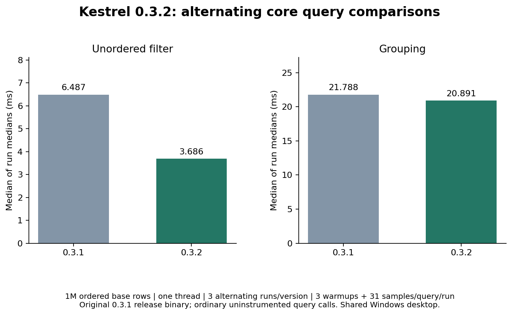

# KestrelSQL 0.3.2: faster filtered scans, unresolved service stalls

The fresh alternating core comparison reduced unordered-filter median time from 6.49 to 3.69 ms. This verifies a focused query improvement. The live sweep also found 236 failed/unexecuted offers at 500/s and 2045.70 ms p99, so this release does not establish an improved production service envelope.

## What changed

A query-local byte buffer and decoded column vectors are reused across streamed pages. Reusable row selections apply each residual predicate with its operator chosen outside the row loop. Sorted bounds already enforce their comparisons. Ungrouped COUNT/SUM/AVG/MIN/MAX kernels dispatch once per expression per page, with exact i128 sums and the existing empty-input semantics. Grouping retains its bounded hash-table path. CRC checks, independent long-scan handles, immutable snapshots and durable publication remain in place. No disk-format change was made.

The new opt-in `snapshot.query_profiled(sql)` returns `(ArchiveResult, ScanProfile)`. It counts scanned candidates/matches and times page read/CRC/decode, selection and aggregation. Ordinary `query` uses a const-generic specialization without per-block timing/counter work. The profile excludes index/planning/result formatting and is query-local; it is not a production tracing service.

## Direct query comparison

Three alternating runs per original 0.3.1 release CLI and final 0.3.2 CLI. Each creates a fresh deterministic 1M-row archive, uses one thread, three warmups and 31 repetitions/query. Every query result matches across versions and every archive passes a full scrub. These are medians of separate run medians, not pooled percentiles.

| Query | 0.3.1 median of run medians, ms | 0.3.2 median of run medians, ms |
|---|---:|---:|
| all_aggregates | 0.0039 | 0.0039 |
| broad_window | 0.0051 | 0.0050 |
| narrow_window | 0.0041 | 0.0041 |
| unordered_filter | 6.4872 | 3.6860 |
| grouped | 21.7879 | 20.8911 |
| min_max | 0.0074 | 0.0074 |



The fresh 0.3.1 baseline differs substantially from earlier shared-desktop measurements. Compare paired builds within this run; substituting earlier absolute timings would overstate the gain.

## Diagnostic profiles

| Instrumented query | Build | Page read/decode, ms | Selection, ms | Aggregate/row loop, ms | Total, ms |
|---|---|---:|---:|---:|---:|
| unordered_filter | Kestrel 0.3.1 | 5.354 | 0.000 | 4.806 | 10.859 |
| unordered_filter | Kestrel 0.3.2 | 2.111 | 0.839 | 0.264 | 3.277 |
| sparse_filter | Kestrel 0.3.1 | 4.954 | 0.000 | 1.764 | 6.856 |
| sparse_filter | Kestrel 0.3.2 | 4.303 | 0.634 | 0.052 | 5.066 |
| multi_filter | Kestrel 0.3.1 | 3.775 | 0.000 | 4.478 | 8.346 |
| multi_filter | Kestrel 0.3.2 | 3.318 | 0.592 | 0.258 | 4.242 |
| grouped | Kestrel 0.3.1 | 5.456 | 0.000 | 25.748 | 31.232 |
| grouped | Kestrel 0.3.2 | 4.915 | 0.172 | 25.485 | 30.644 |
| filtered_group | Kestrel 0.3.1 | 5.214 | 0.000 | 12.019 | 17.433 |
| filtered_group | Kestrel 0.3.2 | 4.565 | 0.867 | 10.054 | 15.717 |

The profiling baseline is a separately preserved 0.3.1 source with timing instrumentation added, rather than the original release binary. Its row-loop stage combines predicate selection and aggregation; 0.3.2 separates those stages. Instrumentation and its counter placement can perturb timings, so this table diagnoses work and does not replace the uninstrumented comparison above. Baseline source and both profiling binaries are included. Each instrumented query has eleven samples after three warmups; all results and full scrubs pass.

The initial profiler compared cold-query bytes with warm-cache bytes and rejected that invalid invariant. It was corrected to compare the same warm state. The first comparison harness also assumed a nested result object rather than the existing flattened JSON shape. Both issues were fixed before the accepted six-case comparison; neither failed setup contributes a performance claim.

## Repeated local service cases

Three 15-second mixed runs per build/engine: 1M base rows, 64 clients, 2,000 offered requests/s, 95% range reads and 5% durable 100-row appends. Three eight-second scan runs at 200/s include grouping, unordered predicates and 10% appends. Variant order rotates, fixtures are fresh, and whole-host observations are retained. This focused release compares two Kestrel builds with DuckDB; the earlier [six-engine matrix](PERFORMANCE_031.md) remains historical evidence rather than a new five-competitor result.

| Build/engine | Median success/s | Median run p99, ms | Run p99 range, ms | Failed/unexecuted offers | 100 ms zero-loss passes |
|---|---:|---:|---:|---:|---:|
| Kestrel 0.3.1 | 1991.07 | 324.42 | 207.25 - 447.83 | 451 / 90000 | 0 / 3 |
| Kestrel 0.3.2 | 1945.67 | 438.89 | 391.57 - 451.45 | 2104 / 90000 | 0 / 3 |
| DuckDB | 1108.93 | 809.27 | 299.77 - 2327.24 | 33309 / 90000 | 0 / 3 |

| Build/engine | Median success/s | Median run p99, ms | Run p99 range, ms | Failed/unexecuted offers | 100 ms zero-loss passes |
|---|---:|---:|---:|---:|---:|
| Kestrel 0.3.1 | 198.12 | 548.14 | 49.68 - 569.39 | 0 / 4800 | 1 / 3 |
| Kestrel 0.3.2 | 199.88 | 361.81 | 196.43 - 713.33 | 0 / 4800 | 0 / 3 |
| DuckDB | 196.75 | 134.52 | 10.59 - 1984.11 | 27 / 4800 | 1 / 3 |

## 10M broad-window regression checks

Three 15-second runs/build at 2,000/s, 64 clients, windows covering 25–50% of base rows, with 5% durable appends. This checks the aggregate-index path alongside the scan change.

| Build/engine | Median success/s | Median run p99, ms | Run p99 range, ms | Failed/unexecuted offers | 100 ms zero-loss passes |
|---|---:|---:|---:|---:|---:|
| Kestrel 0.3.1 | 1869.40 | 714.27 | 679.87 - 755.64 | 6891 / 90000 | 0 / 3 |
| Kestrel 0.3.2 | 1986.13 | 206.85 | 33.87 - 1909.43 | 4625 / 90000 | 1 / 3 |

## Complete candidate sweep and observed stall

| Profile | Clients | Offers/s | Seconds | Success/s | p99, ms | Failed/unexecuted |
|---|---:|---:|---:|---:|---:|---:|
| read | 1 | 500 | 8 | 500.00 | 1.62 | 0 |
| read | 16 | 500 | 8 | 500.00 | 1.65 | 0 |
| read | 64 | 500 | 8 | 500.00 | 1.73 | 0 |
| mixed | 1 | 500 | 8 | 500.00 | 303.54 | 0 |
| mixed | 16 | 500 | 8 | 500.00 | 42.84 | 0 |
| mixed | 64 | 500 | 8 | 430.50 | 2045.70 | 236 |
| write | 64 | 500 | 8 | 493.38 | 470.07 | 0 |
| scan | 64 | 200 | 8 | 199.62 | 335.06 | 0 |
| mixed | 64 | 2000 | 8 | 1999.75 | 58.58 | 0 |
| mixed | 64 | 10000 | 8 | 9100.00 | 187.58 | 7069 |
| mixed | 64 | 500 | 60 | 500.00 | 15.56 | 0 |

In the failed 500/s, 64-client case, catalog-rename maximum rose from 0.34 ms before load to 3398.70 ms, with 4166.92 ms spent in that stage during load. Preparation, writing and synchronization counters remain in the raw report. Long publication stalls can occupy write clients and overflow/expire the shared load-generator queue. This observation does not identify the external filesystem/storage cause or prove a code regression. Both old-build and candidate failures are retained in the paired tables. Physical power loss and a stable service envelope remain unqualified.

Latency starts at scheduled arrival, includes dispatch/queue/service, and reports successes including drain. Throughput counts successes within the arrival window. Errors, queue drops and expired/unexecuted offers remain separate. One request is a query or a complete 100-row append. The queue has 256 slots, two-second expiry and eight-second connection/statement deadlines. No compilation or second heavy job overlapped timed loads.

## Correctness and reproducibility

- 32 Rust tests passed in debug and release, with formatting and Clippy warnings-as-errors. The new oracle test covers signed extremes, partial pages, empty selections, multiple filters, grouping and profile candidate/match counts; existing concurrent and corruption tests still pass.
- 24 new forced process-kill/retry cycles passed atomic published batches, every acknowledged batch, exact sums and full scrubs. Process death is not physical power loss.
- The Parquet replay/backfill demo passed 42 exact DuckDB checks. All 153 retained scale/real-data checks matched, including 100M ordered/late archives; wide imports, partial-row rejection and legacy/downgrade format checks passed.
- A fresh seeded differential suite passed 500 queries against each of DuckDB and SQLite over eight overlapping late-data segments, covering grouped/empty aggregates and all six comparison operators.
- Raw accounting/percentiles, acknowledged writes and 700 independent NumPy windows passed across 35 new stress cases and 620,000 offers, plus 1,116 direct query and 330 diagnostic timings.

```powershell
cargo test --release --locked
cargo build --release --locked --bins --example scan_profile
python benchmarks/core_scan_compare.py --baseline bin/baseline-0.3.1/kestrel.exe --candidate bin/kestrel.exe --baseline-version 0.3.1 --candidate-version 0.3.2 --output benchmarks/perf-032-core.json
python benchmarks/profile_scan_compare.py --baseline bin/baseline-0.3.1/scan-profile.exe --candidate bin/scan-profile.exe
python benchmarks/interleaved_compare.py --baseline bin/baseline-0.3.1/kestrel-stress.exe --candidate bin/kestrel-stress.exe --baseline-version 0.3.1 --candidate-version 0.3.2 --variants baseline,candidate,duckdb --scans --output benchmarks/perf-032-interleaved.json
python benchmarks/report_032.py --plot
```

Install the pinned drivers/plot dependencies first. Historical release sources are in benchmarks/baseline-0.3.1-source; instrumented baseline sources are in benchmarks/profile-baseline-031-source. Build each crate into its own target directory. Source/binary hashes bind the comparisons to [build proof](benchmarks/rust-checks-032.json) and [baseline provenance](benchmarks/baseline-0.3.1-provenance.json).

Evidence: [direct queries](benchmarks/perf-032-core.json), [diagnostics](benchmarks/perf-032-profile.json), [full sweep](benchmarks/perf-032-final.json), [repeated mixed/scans](benchmarks/perf-032-interleaved.json), [10M windows](benchmarks/perf-032-analytics.json), [audit](benchmarks/perf-032-audit.json), [crash checks](benchmarks/perf-032-recovery.json), [pipeline](portfolio/live-pipeline-032-results.json), [retained-data checks](benchmarks/release-recheck-032.json), [format checks](benchmarks/format-032.json), [current capability probes](benchmarks/capability-032.json).

Archive remains a restricted BIGINT aggregate engine. Broad SQL/types, Arrow integration, backups/retention/orphan cleanup, long receipt-ledger endurance, complete resource governance, Linux execution, power-loss behavior and replication remain work. The loopback adapter is unauthenticated and test-only. This prototype has not demonstrated Facebook-scale database activity or universal database superiority.
