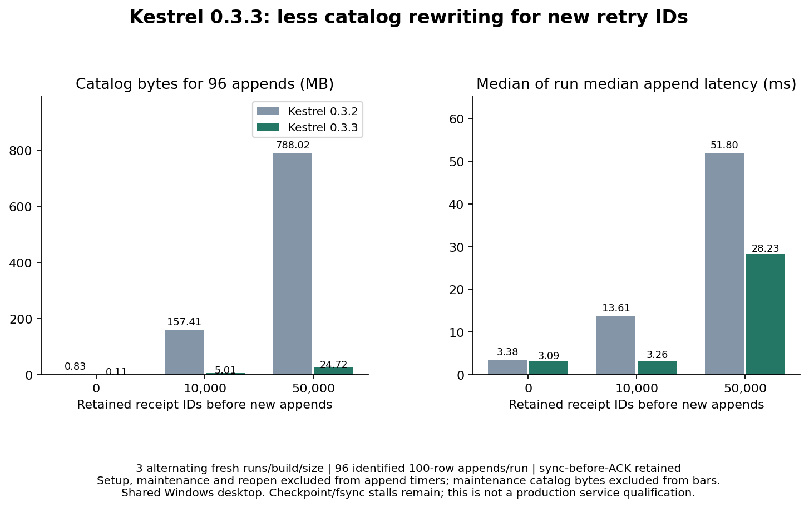

# KestrelSQL 0.3.3: bounded receipt deltas and checkpoints

At 50,000 retained retry IDs, 96 new 100-row appends wrote 788.02 MB of catalogs in 0.3.2 and 24.72 MB in 0.3.3 (96.86% fewer bytes). Median-of-run-median append latency was 51.795 versus 28.229 ms. These three alternating runs measure a focused improvement; service results and failures below remain separate.

## Format and acknowledgment contract

CAT4 stores a full current segment list and either the complete receipt map (checkpoint) or only new receipts with a reference to the previous committed catalog (delta). At most 32 catalog files participate in recovery. The next publication after that bound writes a checkpoint; compactions also consume chain slots. Empty ledgers use checkpoints directly. New writes do not clone the committed in-memory ledger; checkpoints serialize borrowed old/new maps.

Segments still use SEG2. Buffer flush, segment sync, catalog sync and atomic rename remain before successful return/ACK. Recovery checks each envelope, schema, filename/generation, strictly earlier parent, receipt generation, uniqueness and total ID budget. Missing, truncated or corrupt dependencies fail closed without falling back to an older committed catalog. Reclaim retains every current dependency; pinned readers retain payloads separately.

**Upgrade boundary:** reads CAT2/CAT3/CAT4; the first successful write creates CAT4. Older releases reject CAT4. There is no downgrade writer/converter. Work on a copy for an upgrade evaluation. This remains an experimental format, with physical power loss and Windows directory-entry durability unqualified.

This is a checkpointed chain of immutable catalog generations, not an append-in-place WAL. The snapshot/edit design is informed by [RocksDB MANIFEST](https://github.com/facebook/rocksdb/wiki/MANIFEST). [SQLite WAL](https://www.sqlite.org/wal.html) separately documents commit/checkpoint durability tradeoffs. Kestrel retains its existing file-sync acknowledgment boundary; these systems do not establish Kestrel correctness.

## Sequential durable publication

Fresh prefill of 0, 10K or 50K one-row receipt batches in one publication; then 96 identified 100-row appends. Three runs/build/size, old/new order alternates. Append timings exclude prefill, stats, maintenance, full scrubs and reopen. Every 32 appends the probe compacts/reclaims outside the append timer. Catalog byte totals below cover appends, excluding those three maintenance catalogs and initial prefill; stage profiles include maintenance. All raw samples are retained.

| Retained IDs | Build | Median of run medians, ms | Worst append, ms | Catalog MB for 96 appends | Median reopen, ms |
|---:|---|---:|---:|---:|---:|
| 0 | Kestrel 0.3.2 | 3.376 | 61.423 | 0.826 | 0.758 |
| 0 | Kestrel 0.3.3 | 3.088 | 78.284 | 0.112 | 0.944 |
| 10000 | Kestrel 0.3.2 | 13.606 | 539.726 | 157.412 | 9.952 |
| 10000 | Kestrel 0.3.3 | 3.264 | 559.838 | 5.014 | 11.697 |
| 50000 | Kestrel 0.3.2 | 51.795 | 1055.355 | 788.016 | 48.071 |
| 50000 | Kestrel 0.3.3 | 28.229 | 1005.491 | 24.720 | 58.128 |



Checkpoint commits still rewrite the full ledger and can have long tails. Small-file synchronization/rename stalls also remain. Shared-desktop absolute timings vary; compare the fresh paired builds, not earlier release timings. Reopen validates up to 32 catalogs and may cost more. The 100K receipt ceiling remains and no IDs are evicted. Long unique-ID endurance remains unqualified.

## Concurrent service with 50K retained IDs

Each fresh fixture has 1M standard rows and 50K identified seed batches. New appends also carry unique IDs. 64 clients, 2,000 offers/s, 15 seconds, three alternating rounds/build. Mixed has 5% writes; write profile has 25% writes. Each write is a durable 100-row batch. This specifically includes receipt maintenance rather than assuming anonymous-ingest performance applies. Every acknowledged batch and 20 independent NumPy windows per case reconcile after reopen; seed IDs replay with their original receipt generation.

| Build/engine | Median success/s | Median run p99, ms | Run p99 range, ms | Failed/unexecuted offers | Zero-loss / 100 ms passes |
|---|---:|---:|---:|---:|---:|
| Kestrel 0.3.2 | 690.80 | 2089.87 | 1859.02 - 2182.42 | 56413 / 90000 | 0 / 3 |
| Kestrel 0.3.3 | 1751.27 | 714.14 | 698.31 - 846.28 | 12735 / 90000 | 0 / 3 |

| Build/engine | Median success/s | Median run p99, ms | Run p99 range, ms | Failed/unexecuted offers | Zero-loss / 100 ms passes |
|---|---:|---:|---:|---:|---:|
| Kestrel 0.3.2 | 526.67 | 3595.81 | 899.48 - 4030.07 | 55733 / 90000 | 0 / 3 |
| Kestrel 0.3.3 | 1210.47 | 1175.92 | 1097.94 - 1273.06 | 31434 / 90000 | 0 / 3 |

## Anonymous mixed and generic scans

Three rotated runs/engine, fresh 1M fixtures: mixed at 2,000/s for 15 seconds (5% appends); scans at 200/s for eight seconds (10% appends). DuckDB is the fresh reference in this focused release; the preceding six-engine comparison remains historical.

| Build/engine | Median success/s | Median run p99, ms | Run p99 range, ms | Failed/unexecuted offers | Zero-loss / 100 ms passes |
|---|---:|---:|---:|---:|---:|
| Kestrel 0.3.2 | 1999.80 | 44.17 | 15.44 - 141.91 | 0 / 90000 | 2 / 3 |
| Kestrel 0.3.3 | 1999.67 | 128.56 | 16.57 - 146.15 | 0 / 90000 | 1 / 3 |
| DuckDB | 1380.73 | 588.04 | 431.98 - 620.74 | 25688 / 90000 | 0 / 3 |

| Build/engine | Median success/s | Median run p99, ms | Run p99 range, ms | Failed/unexecuted offers | Zero-loss / 100 ms passes |
|---|---:|---:|---:|---:|---:|
| Kestrel 0.3.2 | 199.62 | 203.88 | 103.34 - 548.16 | 0 / 4800 | 0 / 3 |
| Kestrel 0.3.3 | 199.62 | 236.99 | 199.03 - 245.14 | 0 / 4800 | 0 / 3 |
| DuckDB | 199.50 | 98.43 | 58.66 - 189.36 | 0 / 4800 | 2 / 3 |

## Complete candidate sweep

| Profile | Clients | Offers/s | Seconds | Success/s | p99, ms | Failed/unexecuted |
|---|---:|---:|---:|---:|---:|---:|
| read | 1 | 500 | 8 | 500.00 | 1.65 | 0 |
| read | 16 | 500 | 8 | 500.00 | 1.70 | 0 |
| read | 64 | 500 | 8 | 500.00 | 1.58 | 0 |
| mixed | 1 | 500 | 8 | 353.00 | 1765.06 | 1176 |
| mixed | 16 | 500 | 8 | 500.00 | 602.95 | 0 |
| mixed | 64 | 500 | 8 | 500.00 | 11.01 | 0 |
| write | 64 | 500 | 8 | 496.25 | 159.46 | 0 |
| scan | 64 | 200 | 8 | 199.62 | 93.45 | 0 |
| mixed | 64 | 2000 | 8 | 1999.75 | 95.33 | 0 |
| mixed | 64 | 10000 | 8 | 7697.75 | 316.37 | 18098 |
| mixed | 64 | 500 | 60 | 500.00 | 160.94 | 0 |

The repeated zero-loss / 100 ms target across candidate mixed, scan and receipt write cases failed. Even passing short local targets would not establish production readiness. All loss/expiry/errors and slow cases are retained. Latency starts at scheduled arrival and percentiles describe successes including drain; throughput counts successes in the arrival window. Queue: 256 slots, two-second expiry, eight-second connection/statement deadlines. Whole-host CPU/memory observations do not identify a storage-stall cause.

## Core query regression checks

Original 0.3.2 release CLI versus final default-feature 0.3.3 CLI, one thread, three fresh alternating 1M-row archives per build, three warmups and 31 samples/query. All 36 query results match and every payload passes a full scrub.

| Query | 0.3.2 median of run medians, ms | 0.3.3 median of run medians, ms |
|---|---:|---:|
| all_aggregates | 0.0044 | 0.0048 |
| broad_window | 0.0052 | 0.0050 |
| narrow_window | 0.0066 | 0.0044 |
| unordered_filter | 3.6042 | 3.5852 |
| grouped | 20.9381 | 20.7644 |
| min_max | 0.0075 | 0.0074 |

## Correctness and fault evidence

- 35 Rust tests pass in debug and release; formatting and Clippy warnings-as-errors pass. New tests cover checkpoint/reclaim/reopen, all original receipt generations, damaged chain semantics and a real pending-file creation failure.
- 56 exact cut-point cases pass: seven points, process exit and injected disk-full OS error, append/compaction and delta/checkpoint. A separate feature-enabled driver fails before/after segment writes/sync, catalog writes/sync and publication. Default binaries recover. All original receipts, atomic rows/sums, retry decisions and full scrubs pass. Injected errors poison the writer while the old pinned view stays readable. This is not actual device exhaustion or physical power loss.
- 22 additional corruption cases reject every truncated envelope-header prefix, selected body truncations, excess chain depth and duplicate JSON receipt keys. Ten semantic/dependency corruption cases are also in the Rust regression.
- 24 random-delay forced-kill/retry cycles pass acknowledged data, atomic batches, exact sums and full scrubs. 500 fresh queries match each of DuckDB and SQLite; the Parquet replay/backfill demo passes 42 exact checks; 153 retained large/real-data queries match, including 100M-row archives.
- CAT2/CAT3 reads, CAT4 upgrade, original CAT3 receipt generations and older-binary rejection pass. Payload format remains SEG2.
- Audit covers 41 stress cases, 800,000 offers and 820 independent NumPy windows, plus 1,728 append timings and 1,116 core query timings. No compilation, plotting, packaging or other heavy job overlapped timed workloads. All task-owned bridge/reference processes stop after each comparison.

## Reproduce

The first retained-receipt service setup failed before any timed offers: a preparation-script path variable was reused and provenance JSON overwrote the copied baseline seed executable. It was restored from the isolated build, provenance was regenerated with distinct variables, and executable headers were checked before the accepted runs. Completed publication/core/anonymous comparisons were unaffected. [Setup failure evidence](benchmarks/perf-033-receipt-setup-failure.json) is excluded from speed measurements.

Build historical and candidate crates in separate target directories. The added publication and seed probe sources are identical in both crates and their hashes are recorded. Run commands sequentially after installing pinned benchmark dependencies.

```powershell
cargo test --release --locked
cargo build --release --locked --bins --example publication_probe --example receipt_seed
python benchmarks/publication_compare.py --baseline bin/baseline-0.3.2/publication-probe.exe --candidate bin/publication-probe.exe --output benchmarks/publication-033-paired.json
python benchmarks/receipt_service_compare.py --baseline bin/baseline-0.3.2/kestrel-stress.exe --candidate bin/kestrel-stress.exe --baseline-seed bin/baseline-0.3.2/receipt-seed.exe --candidate-seed bin/receipt-seed.exe --output benchmarks/perf-033-receipts.json
python benchmarks/report_033.py --plot
```

Fault driver: build `cargo build --release --locked --features fault-injection --example publication_fault_probe` in a separate target directory. Default shipped CLI/bridge use no features and contain no failure environment hooks. Test-only driver is labeled in `bin/test-only`. Source and binary hashes: [build proof](benchmarks/rust-checks-033.json), [baseline provenance](benchmarks/baseline-0.3.2-provenance.json).

Evidence: [publication timings](benchmarks/publication-033-paired.json), [initial baseline](benchmarks/publication-033-baseline-initial.json), [cut points](benchmarks/publication-033-faults.json), [receipt loads](benchmarks/perf-033-receipts.json), [mixed/scans](benchmarks/perf-033-interleaved.json), [full sweep](benchmarks/perf-033-final.json), [core](benchmarks/perf-033-core.json), [audit](benchmarks/perf-033-audit.json), [random kills](benchmarks/perf-033-recovery.json), [format](benchmarks/format-033.json).

Archive remains a restricted BIGINT aggregate engine. Arrow/types/NULL/decimal semantics, backups/retention/orphan cleanup, resource governance, long endurance, Linux execution, power-loss behavior and replication remain work. No universal superiority, production certification or Facebook-scale qualification is established.
