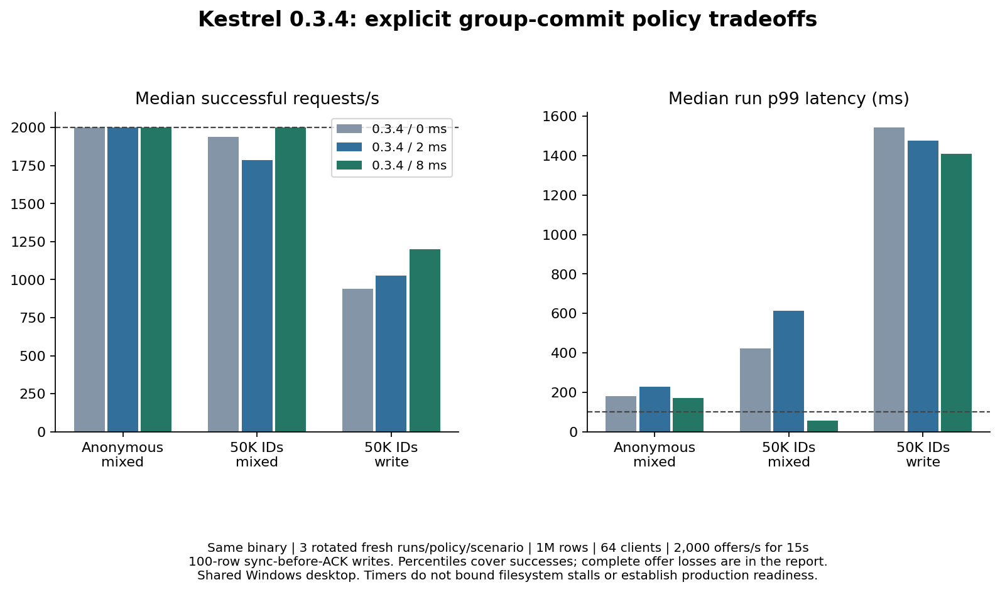

# KestrelSQL 0.3.4: bounded group-commit policy experiment

The release adds an explicit coalescing window and group-collection diagnostics. In three independent 50K-ID / 25%-write confirmation rounds, the 8 ms policy's median success rate was 1200.07/s versus 939.53/s at zero delay. Its median run p99 was 1410.02 versus 1542.30 ms, with 38348 versus 45788 lost offers out of 90,000 per policy. The initial tuning run regressed with 8 ms; other scenarios also have mixed results. The default remains **0 ms**. Every setting and failure is retained; no policy qualifies the repeated normal-load target.

## Contract and hypothesis

The 0.3.3 retained 50K-ID profiles spend most publication time in segment/catalog synchronization rather than preparation. Fewer publications might amortize those waits. [PostgreSQL WAL settings](https://www.postgresql.org/docs/18/runtime-config-wal.html) document the throughput/latency tradeoff of commit delays; Kestrel has a different immutable two-file publication design.

`LiveOptions.max_group_delay` allows 0..20 ms. One deadline starts when the writer receives its first request and never slides. It collects at most 64 requests; the existing 256-request / 64 MiB queue remains. A disconnected queue drains without a timer wait. Intentional collection waiting is bounded; scheduler, queued work, synchronization and compaction are not acknowledgment-time bounds. A single write and an exact retry can pay the full optional window. Statistics report exact configured nanoseconds, collection time, collected groups and maximum group requests. Readers receive the committed snapshot before ACK; flush, segment/catalog sync and atomic publication are unchanged.

## Initial tuning evidence

One fresh run per old build / new 0/2/8 ms setting and scenario. These runs informed a separate confirmation; they are not pooled to inflate its repetition count.

| Scenario | Policy / engine | Median success/s | Median p99, ms (range) | Median append p99, ms | Lost offers / total | Zero-loss / 100 ms passes |
|---|---|---:|---:|---:|---:|---:|
| anonymous-mixed | 0.3.3 default | 1998.73 | 303.78 (303.78–303.78) | 494.47 | 0 / 30000 | 0 / 1 |
| anonymous-mixed | 0.3.4 / 0 ms | 1984.80 | 322.10 (322.10–322.10) | 686.25 | 218 / 30000 | 0 / 1 |
| anonymous-mixed | 0.3.4 / 2 ms | 1999.27 | 324.63 (324.63–324.63) | 582.16 | 0 / 30000 | 0 / 1 |
| anonymous-mixed | 0.3.4 / 8 ms | 1957.60 | 357.45 (357.45–357.45) | 1041.78 | 629 / 30000 | 0 / 1 |
| receipt-mixed | 0.3.3 default | 1683.67 | 845.31 (845.31–845.31) | 1474.47 | 4711 / 30000 | 0 / 1 |
| receipt-mixed | 0.3.4 / 0 ms | 1720.60 | 853.21 (853.21–853.21) | 1391.56 | 4156 / 30000 | 0 / 1 |
| receipt-mixed | 0.3.4 / 2 ms | 1632.67 | 1001.30 (1001.30–1001.30) | 1484.24 | 5190 / 30000 | 0 / 1 |
| receipt-mixed | 0.3.4 / 8 ms | 1880.40 | 555.32 (555.32–555.32) | 1139.11 | 1791 / 30000 | 0 / 1 |
| receipt-write | 0.3.3 default | 1975.53 | 189.13 (189.13–189.13) | 258.40 | 349 / 30000 | 0 / 1 |
| receipt-write | 0.3.4 / 0 ms | 1858.33 | 415.39 (415.39–415.39) | 504.84 | 1992 / 30000 | 0 / 1 |
| receipt-write | 0.3.4 / 2 ms | 1759.33 | 1367.15 (1367.15–1367.15) | 1558.30 | 3290 / 30000 | 0 / 1 |
| receipt-write | 0.3.4 / 8 ms | 1428.73 | 1166.28 (1166.28–1166.28) | 1213.05 | 8259 / 30000 | 0 / 1 |

## Independent policy confirmation

Same final 0.3.4 binary, 0/2/8 ms, three rotating rounds, fresh 1M-row fixtures, 64 clients, 2,000 offers/s, 15 seconds. Anonymous mixed uses 5% writes; receipt mixed and receipt write use 5% and 25% writes respectively with 50K initial retained IDs. Each append contains 100 rows. Fixture seed and full scrub are outside arrivals. The seed receipt replays with original generation 1. Every ACK reconciles after reopen; 20 NumPy windows/case and full payload scrubs pass.

| Scenario | Policy / engine | Median success/s | Median p99, ms (range) | Median append p99, ms | Lost offers / total | Zero-loss / 100 ms passes |
|---|---|---:|---:|---:|---:|---:|
| anonymous-mixed | 0.3.4 / 0 ms | 1999.40 | 179.34 (118.45–215.74) | 361.13 | 0 / 90000 | 0 / 3 |
| anonymous-mixed | 0.3.4 / 2 ms | 1999.07 | 227.34 (112.22–412.54) | 507.61 | 743 / 90000 | 0 / 3 |
| anonymous-mixed | 0.3.4 / 8 ms | 1999.67 | 171.98 (131.44–208.03) | 381.98 | 0 / 90000 | 0 / 3 |
| receipt-mixed | 0.3.4 / 0 ms | 1937.00 | 422.80 (51.32–963.02) | 905.00 | 2779 / 90000 | 1 / 3 |
| receipt-mixed | 0.3.4 / 2 ms | 1787.67 | 614.00 (51.52–1352.44) | 1209.54 | 7143 / 90000 | 1 / 3 |
| receipt-mixed | 0.3.4 / 8 ms | 1999.60 | 56.45 (48.32–72.90) | 296.26 | 4610 / 90000 | 2 / 3 |
| receipt-write | 0.3.4 / 0 ms | 939.53 | 1542.30 (1147.58–1818.06) | 1657.37 | 45788 / 90000 | 0 / 3 |
| receipt-write | 0.3.4 / 2 ms | 1026.33 | 1474.85 (1357.04–1616.72) | 1835.86 | 44118 / 90000 | 0 / 3 |
| receipt-write | 0.3.4 / 8 ms | 1200.07 | 1410.02 (1123.24–1524.76) | 1494.55 | 38348 / 90000 | 0 / 3 |



| Scenario | Policy | Median durable groups | Median batches/group | Median run mean collection, ms |
|---|---|---:|---:|---:|
| anonymous-mixed | 0.3.4 / 0 ms | 316 | 4.69 | 0.002 |
| anonymous-mixed | 0.3.4 / 2 ms | 349 | 4.25 | 6.930 |
| anonymous-mixed | 0.3.4 / 8 ms | 226 | 6.56 | 12.992 |
| receipt-mixed | 0.3.4 / 0 ms | 673 | 2.07 | 0.001 |
| receipt-mixed | 0.3.4 / 2 ms | 346 | 3.74 | 6.919 |
| receipt-mixed | 0.3.4 / 8 ms | 478 | 3.10 | 12.683 |
| receipt-write | 0.3.4 / 0 ms | 111 | 30.98 | 0.010 |
| receipt-write | 0.3.4 / 2 ms | 130 | 28.19 | 2.782 |
| receipt-write | 0.3.4 / 8 ms | 129 | 34.91 | 8.700 |

Group counts and batches/group show whether an explicit window actually changes publication frequency. Actual mean collection can exceed the configured window on this host; the counter includes collection execution and scheduling, and does not isolate an overshoot cause. A deadline prevents intentional sliding waits, but cannot ensure wall-clock wakeup. Whole-host observations and publication-stage counters are retained. Shared-desktop order rotation reduces one source of bias; these are descriptive measurements without controlled storage isolation or statistical confidence intervals.

## Fresh anonymous reference

0/8 ms policies and DuckDB, three rotated 15-second anonymous mixed runs. DuckDB uses its native Python binding, one thread per connection and 256 MB configured memory; Kestrel uses the Rust loopback test bridge. This is an aggregate workload with different API boundaries and SQL coverage. Earlier six-engine results remain historical in [HARD_TESTS.md](HARD_TESTS.md) and [PERFORMANCE_031.md](PERFORMANCE_031.md).

| Scenario | Policy / engine | Median success/s | Median p99, ms (range) | Median append p99, ms | Lost offers / total | Zero-loss / 100 ms passes |
|---|---|---:|---:|---:|---:|---:|
| anonymous-mixed | 0.3.4 / 0 ms | 1999.60 | 180.13 (34.51–264.96) | 421.39 | 0 / 90000 | 1 / 3 |
| anonymous-mixed | 0.3.4 / 8 ms | 1998.93 | 226.97 (201.73–509.18) | 493.37 | 1307 / 90000 | 0 / 3 |
| anonymous-mixed | DuckDB | 1521.27 | 580.93 (284.20–1157.34) | 554.05 | 23830 / 90000 | 0 / 3 |

## Boundary and sustained checks

One fresh 8-second case/policy/scenario: single client at 500/s, 64-client 10K/s burst, and 64-client generic scans at 200/s. These are regression screens, not repeated qualification. Scans contain 10% appends. Single-client cases disclose the batching/serialization cost.

| Scenario | Policy / engine | Median success/s | Median p99, ms (range) | Median append p99, ms | Lost offers / total | Zero-loss / 100 ms passes |
|---|---|---:|---:|---:|---:|---:|
| single-mixed | 0.3.4 / 0 ms | 295.12 | 1417.70 (1417.70–1417.70) | 1290.72 | 1382 / 4000 | 0 / 1 |
| single-mixed | 0.3.4 / 2 ms | 265.50 | 1707.40 (1707.40–1707.40) | 1665.24 | 1619 / 4000 | 0 / 1 |
| single-mixed | 0.3.4 / 8 ms | 308.62 | 1488.88 (1488.88–1488.88) | 1531.58 | 1274 / 4000 | 0 / 1 |
| burst | 0.3.4 / 0 ms | 5079.00 | 418.09 (418.09–418.09) | 548.84 | 39048 / 80000 | 0 / 1 |
| burst | 0.3.4 / 2 ms | 7001.00 | 135.40 (135.40–135.40) | 292.38 | 23660 / 80000 | 0 / 1 |
| burst | 0.3.4 / 8 ms | 7315.75 | 156.89 (156.89–156.89) | 549.41 | 21145 / 80000 | 0 / 1 |
| scan | 0.3.4 / 0 ms | 199.62 | 105.74 (105.74–105.74) | 115.31 | 0 / 1600 | 0 / 1 |
| scan | 0.3.4 / 2 ms | 199.62 | 110.21 (110.21–110.21) | 227.55 | 0 / 1600 | 0 / 1 |
| scan | 0.3.4 / 8 ms | 199.62 | 106.15 (106.15–106.15) | 110.19 | 0 / 1600 | 0 / 1 |

One fresh 60-second anonymous mixed case per 0/8 ms policy, 64 clients at 2K/s. This is one minute, not long endurance or distributed activity.

| Scenario | Policy / engine | Median success/s | Median p99, ms (range) | Median append p99, ms | Lost offers / total | Zero-loss / 100 ms passes |
|---|---|---:|---:|---:|---:|---:|
| anonymous-mixed | 0.3.4 / 0 ms | 1999.93 | 79.82 (79.82–79.82) | 471.98 | 0 / 120000 | 1 / 1 |
| anonymous-mixed | 0.3.4 / 8 ms | 1861.55 | 195.72 (195.72–195.72) | 2796.27 | 8300 / 120000 | 0 / 1 |

**Service qualification:** failed; experimental optional tuning, production envelope unqualified. The target requires zero loss and successful scheduled-arrival p99 ≤100 ms in each policy's nine independent 2K/s confirmation cases; tuning, references, burst screens and the minute screen are separate evidence. Scheduled-arrival latency includes queueing; percentiles cover successes including drain. All failures, queue drops and two-second expiries are separate. Socket deadlines remain eight seconds. The user-visible server adapter remains test-only and unauthenticated.

## Correctness and evidence boundaries

- 38 Rust tests pass in debug/release; format and Clippy pass. New checks cover option limits, zero default, 64-request cap, closed-queue draining, concurrent receipts/retries, ACK snapshot visibility, pinned views and reopen scrubs.
- 32 new forced process-kill cycles: sixteen simultaneous producers, 0/2/8/20 ms policies and eight kill delays. Acknowledged data remains present; every recovered batch is whole; exact retry and original receipt generations survive a second reopen. Unknown unacknowledged commits are disclosed. These are live-filesystem process deaths, not physical power cuts.
- The 8 ms Parquet pipeline ingests 30K rows, replays both sources without duplication, rejects changed content under an existing ID, and matches 42 DuckDB SQL results.
- Storage, query planner, query kernels, original WAL and CLI source hashes exactly match 0.3.3. Its 56 exact publication-cut cases, 22 extra corruption rejections, format upgrades, 500-query differential and 100M/NYC checks are inherited evidence, not new 0.3.4 tests. CAT4/SEG2 are unchanged. The 0.3.3 writer reads 0.3.4 stores in the packaged smoke.
- 59 new stress cases / 1,936,800 offers; every retained raw sample, percentile and loss account is audited. No compilation or other task-heavy workload overlaps timed arrivals. Each task-owned bridge stops after its case.

The 100K receipt ceiling, checkpoint stalls, restricted BIGINT aggregate SQL, missing backup/retention/orphan cleanup, physical power loss and Windows directory-entry durability remain limits. No universal superiority, Facebook-scale or production-ready claim follows from this experiment.

## Reproduce

```powershell
cargo test --release --locked
cargo build --release --locked --bins --examples
python benchmarks/group_commit_compare.py --baseline bin/baseline-0.3.3/kestrel-stress.exe --candidate bin/kestrel-stress.exe --baseline-seed bin/baseline-0.3.3/receipt-seed.exe --candidate-seed bin/receipt-seed.exe --variants delay0,delay2,delay8 --rounds 3 --seconds 15 --output benchmarks/my-policy-confirmation.json
python benchmarks/group_commit_recovery.py --binary bin/kestrel-stress.exe --output benchmarks/my-policy-recovery.json
python benchmarks/live_pipeline_demo.py --binary bin/kestrel-stress.exe --group-delay-ms 8 --output portfolio/my-delayed-pipeline.json
python benchmarks/report_034.py --plot
```

Use the existing requirements in [stress_requirements.txt](benchmarks/stress_requirements.txt). Run timing suites serially. For the initial evidence use `--rounds 1 --variants baseline,delay0,delay2,delay8`; for fresh references use `--profiles anonymous-mixed --variants delay0,delay8,duckdb --rounds 3`; for boundary checks use `--profiles single-mixed,burst,scan --variants delay0,delay2,delay8 --rounds 1 --seconds 8`; for the minute screen use `--profiles anonymous-mixed --variants delay0,delay8 --rounds 1 --seconds 60`. Use new output paths to preserve retained evidence.

Reports: [tuning](benchmarks/perf-034-tuning.json), [confirmation](benchmarks/perf-034-confirmation.json), [reference](benchmarks/perf-034-reference.json), [boundaries](benchmarks/perf-034-boundaries.json), [minute screen](benchmarks/perf-034-soak.json), [sample audit](benchmarks/perf-034-audit.json), [concurrent recovery](benchmarks/group-034-recovery.json), [delayed pipeline](portfolio/live-pipeline-034-results.json), [build proof](benchmarks/rust-checks-034.json).
