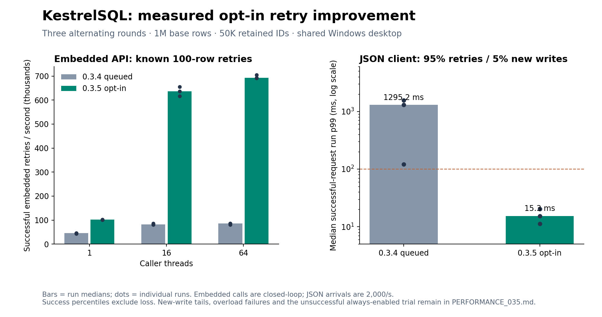

# KestrelSQL 0.3.5: opt-in confirmed retries during live ingestion

Experimental prototype on one shared Windows computer. The change makes confirmed exact retries independent of writer queueing and coalescing. It does not qualify production durability, a distributed service, Facebook-scale traffic or universal superiority. Fresh-write controls and every losing case are retained below.

On the final 95%-retry / 5%-new-write fixture, median combined p99 changes from 1295.24 to 15.35 ms; final enabled runs lose 0 of 90,000 offers versus 39,492 for the baseline. New-write tails remain separate. The initial always-enabled write-heavy control regressed materially, so the added map stays off by default.

## Change and contract

`LiveArchive::with_retry_index(archive, LiveOptions::default())` opts into a lookup cloned once at startup. `new` and `with_options` allocate no second map and keep queued retries. Enabled wrappers extend the lookup only after synchronized publication and publication of the read snapshot, before ACKs. Every known retry still checks shape, SHA-256 of the exact submitted column/row order, and the original receipt generation. The lookup lock is released before hashing. Unknown and pending IDs retain writer admission and whole-group conflict behavior; known conflicts fail independently. Observed writer poisoning or exit rejects both fast and new appends until reopening. Old snapshots remain readable.

The extra lookup is bounded by the existing 100K-ID ceiling; `retry_index_logical_bytes` counts key capacity, String values and fixed receipt records, excluding tree nodes and allocator overhead. It adds memory and startup work. New receipts extend it incrementally; there is no full-map copy per commit. CAT4/SEG2 and the fingerprint domain are unchanged. Default collection delay remains zero.

## Method

Frozen 0.3.4 baseline and 0.3.5 candidate; fresh 1M standard-row fixtures with 50,000 retained IDs. Retry cases add 128 committed 100-row known batches before arrivals and retain their original generations. 64 clients, 256 client queue slots, 2-second expiry, 8-second socket timeout, deterministic paced arrivals. `retry-only` offers 100% known retries; `retry-mixed` offers 95% retries and 5% new identified 100-row writes. Main comparisons use 2,000 offers/s for 15 seconds, three rotating rounds. In the initial trial, `baseline` / `baseline8` are 0.3.4 at 0 / 8 ms; `delay0` / `delay8` are the initial 0.3.5 build with the map always enabled at 0 / 8 ms. Final labels are defined with their tables below. Fixture build, scrubs, reconciliation and compression are outside arrivals.

Req/s counts successful completions inside arrivals. Percentiles include successful requests only; losses include every error, drop and expiry separately. Medians are across run summaries, not pooled percentiles. The 10K retry screen is eight seconds and is an overload screen, not sustained capacity. Client JSON/Python costs, Windows scheduling and shared-desktop activity are included. No compilation or other task CPU-heavy job runs during any timed database workload. Only task-owned database processes are used and stopped.

The first always-on trial regressed the write-heavy control: median completion fell from 1,977.87 to 955.67 req/s, with 31,231 failed/unexecuted candidate offers versus 652 for the baseline over 90K offers each. The slow candidate runs spent most measured publication time in synchronization. This does not establish lookup CPU as the cause, but it prevented enabling the extra state by default. The trial source, binaries, harnesses, proof and all samples are preserved separately. Final comparisons below use the rebuilt opt-in API.

## Final repeated retry comparisons

Here `baseline` is frozen 0.3.4 at zero delay; `indexed0` is the final 0.3.5 build with the lookup explicitly enabled at zero delay. Three alternating rounds, same fixture and client workload.

| Scenario / variant | Median req/s | Median run p99 ms | Run p99 range ms | Loss / offers | Runs meeting zero loss + p99 ≤100 ms |
|---|---:|---:|---:|---:|---:|
| retry-mixed/baseline | 668.80 | 1295.24 | 121.87–1564.54 | 39,492 / 90,000 | 0 / 3 |
| retry-mixed/indexed0 | 1999.87 | 15.35 | 11.30–20.27 | 0 / 90,000 | 3 / 3 |
| retry-only/baseline | 1999.93 | 1.58 | 1.54–1.71 | 0 / 90,000 | 3 / 3 |
| retry-only/indexed0 | 1999.93 | 1.72 | 1.59–1.80 | 0 / 90,000 | 3 / 3 |

Separate retry and new-write tails reveal whether a favorable combined percentile hides ingestion problems:

| Variant | Median retry arrival p99 ms | Median retry call p99 ms | Median new-write arrival p99 ms | Failed/unexecuted new writes | Failed/unexecuted retries |
|---|---:|---:|---:|---:|---:|
| baseline | 1295.56 | 1111.02 | 1271.82 | 1,846 | 37,646 |
| indexed0 | 1.69 | 0.88 | 136.47 | 0 | 0 |

Arrival latency includes waiting in the shared client worker pool. Call latency begins when a worker starts the operation and includes JSON, network and database work; it is not server-only time. If slow writes occupy all workers, even a database retry that bypasses the writer can wait before dispatch. All affected retries and new-write losses remain in the same report. Splitting caller capacity is a future experiment, not a delivered guarantee.

- baseline: synchronized segment/catalog stages account for 86.13% of the sum of seven timed publication stages over the three retry-mixed loads. This is process-local profiling, not device attribution.
- indexed0: synchronized segment/catalog stages account for 53.81% of the sum of seven timed publication stages over the three retry-mixed loads. This is process-local profiling, not device attribution.

## 10,000 offered retries/s

| Scenario / variant | Median req/s | Median run p99 ms | Run p99 range ms | Loss / offers | Runs meeting zero loss + p99 ≤100 ms |
|---|---:|---:|---:|---:|---:|
| retry-burst/baseline | 6567.12 | 81.91 | 50.96–83.87 | 75,044 / 240,000 | 0 / 3 |
| retry-burst/delay0 | 6753.25 | 83.38 | 71.70–88.95 | 81,164 / 240,000 | 0 / 3 |

This overload screen used the initial always-on trial. It did not establish a clear JSON-client throughput gain and is preserved without replacement. It is not a final-default measurement.

## Embedded Rust API comparison

The identical test probe is compiled on verified copies of both source trees after open-loop loads stop. A compatibility trait invokes the original queued constructor on 0.3.4; the candidate's inherent opt-in constructor takes precedence on 0.3.5. No network, JSON or Python client loop is inside these timed calls. Every call clones the same 100-row payload and checks duplicate status, row count and original generation. Five-second closed-loop runs at 1/16/64 caller threads, three alternating rounds, 50K retained IDs and 1M base rows. Fixture construction, initial publication and full scrub are outside timing. Call counts are complete; latency is systematically sampled every 64 calls per worker and retained. This isolates the embedded API; it does not qualify an arrival-rate SLO or compare other database engines.

| Caller threads | Baseline median calls/s | Enabled candidate median calls/s | Ratio | Baseline sampled p99 µs | Candidate sampled p99 µs |
|---:|---:|---:|---:|---:|---:|
| 1 | 45,886 | 102,069 | 2.22× | 55.30 | 16.50 |
| 16 | 81,880 | 636,140 | 7.77× | 379.00 | 39.00 |
| 64 | 85,390 | 692,731 | 8.11× | 1352.60 | 43.30 |

## Fresh-write and anonymous controls

Anonymous mixed contains 5% new anonymous writes; receipt mixed and receipt write contain 5% and 25% new identified writes respectively. Both use the default 0 ms policy. Receipt controls retain 50K IDs. These workloads do not exercise known fast retries, so any improvement or regression is an indirect effect or desktop variance.

Final `baseline` is 0.3.4; `delay0` is 0.3.5 default with no second map; `indexed0` enables it on the same final binary.

| Scenario / variant | Median req/s | Median run p99 ms | Run p99 range ms | Loss / offers | Runs meeting zero loss + p99 ≤100 ms |
|---|---:|---:|---:|---:|---:|
| anonymous-mixed/baseline | 1999.80 | 5.06 | 4.94–33.56 | 0 / 90,000 | 3 / 3 |
| anonymous-mixed/delay0 | 1999.73 | 34.60 | 5.16–41.05 | 0 / 90,000 | 3 / 3 |
| anonymous-mixed/indexed0 | 1999.80 | 32.45 | 4.62–32.48 | 0 / 90,000 | 3 / 3 |
| receipt-mixed/baseline | 1999.60 | 22.88 | 18.36–32.27 | 0 / 90,000 | 3 / 3 |
| receipt-mixed/delay0 | 1999.60 | 21.60 | 21.36–25.69 | 0 / 90,000 | 3 / 3 |
| receipt-mixed/indexed0 | 1999.73 | 21.41 | 18.86–206.76 | 301 / 90,000 | 2 / 3 |
| receipt-write/baseline | 1991.87 | 166.19 | 156.18–323.95 | 850 / 90,000 | 0 / 3 |
| receipt-write/delay0 | 1981.67 | 195.89 | 144.02–196.65 | 553 / 90,000 | 0 / 3 |
| receipt-write/indexed0 | 1901.67 | 612.57 | 164.63–1246.36 | 17,752 / 90,000 | 0 / 3 |

The initial always-on control is retained separately:

| Scenario / variant | Median req/s | Median run p99 ms | Run p99 range ms | Loss / offers | Runs meeting zero loss + p99 ≤100 ms |
|---|---:|---:|---:|---:|---:|
| anonymous-mixed/baseline | 1999.73 | 16.18 | 8.74–43.19 | 0 / 90,000 | 3 / 3 |
| anonymous-mixed/delay0 | 1999.47 | 10.57 | 8.13–38.75 | 0 / 90,000 | 3 / 3 |
| receipt-mixed/baseline | 1999.53 | 34.65 | 26.67–46.41 | 0 / 90,000 | 3 / 3 |
| receipt-mixed/delay0 | 1999.67 | 34.60 | 22.70–34.96 | 0 / 90,000 | 3 / 3 |
| receipt-write/baseline | 1977.87 | 199.95 | 135.68–201.69 | 652 / 90,000 | 0 / 3 |
| receipt-write/delay0 | 955.67 | 1179.95 | 214.86–1193.59 | 31,231 / 90,000 | 0 / 3 |

## Fresh DuckDB reference

Anonymous 5%-write workload only, same open-loop harness, three rotating rounds. This preserves the historical reference interface and does not compare idempotent receipt semantics or broad SQL capability parity.

| Scenario / variant | Median req/s | Median run p99 ms | Run p99 range ms | Loss / offers | Runs meeting zero loss + p99 ≤100 ms |
|---|---:|---:|---:|---:|---:|
| anonymous-mixed/delay0 | 1999.73 | 6.22 | 5.89–33.60 | 0 / 90,000 | 3 / 3 |
| anonymous-mixed/duckdb | 1999.60 | 51.52 | 21.29–84.45 | 0 / 90,000 | 3 / 3 |
| anonymous-mixed/indexed0 | 1999.73 | 47.41 | 5.93–47.92 | 0 / 90,000 | 3 / 3 |

The initial trial/reference runs are preserved in the linked raw report and not pooled into final comparisons.

## Initial baseline evidence

Four exploratory 0.3.4 cases ran before implementation. They motivated the change, have only one round, and are not pooled into confirmation.

| Scenario / variant | Median req/s | Median run p99 ms | Run p99 range ms | Loss / offers | Runs meeting zero loss + p99 ≤100 ms |
|---|---:|---:|---:|---:|---:|
| retry-mixed/baseline | 1931.93 | 343.93 | 343.93–343.93 | 1,018 / 30,000 | 0 / 1 |
| retry-mixed/delay8 | 953.07 | 1259.34 | 1259.34–1259.34 | 15,625 / 30,000 | 0 / 1 |
| retry-only/baseline | 1999.87 | 4.18 | 4.18–4.18 | 0 / 30,000 | 1 / 1 |
| retry-only/delay8 | 1998.87 | 12.60 | 12.60–12.60 | 0 / 30,000 | 1 / 1 |

The initial always-on same-binary 0/8 ms retry trial is also preserved:

| Scenario / variant | Median req/s | Median run p99 ms | Run p99 range ms | Loss / offers | Runs meeting zero loss + p99 ≤100 ms |
|---|---:|---:|---:|---:|---:|
| retry-mixed/baseline | 1982.27 | 203.00 | 164.38–1444.95 | 20,296 / 90,000 | 0 / 3 |
| retry-mixed/baseline8 | 1977.40 | 154.99 | 150.56–206.01 | 544 / 90,000 | 0 / 3 |
| retry-mixed/delay0 | 1999.87 | 28.08 | 23.73–1116.00 | 6,926 / 90,000 | 2 / 3 |
| retry-mixed/delay8 | 1999.73 | 38.06 | 33.78–807.06 | 4,262 / 90,000 | 2 / 3 |
| retry-only/baseline | 1999.47 | 7.31 | 1.86–100.68 | 22 / 90,000 | 2 / 3 |
| retry-only/baseline8 | 1998.87 | 12.26 | 12.24–15.11 | 0 / 90,000 | 3 / 3 |
| retry-only/delay0 | 1999.73 | 2.94 | 1.93–3.82 | 0 / 90,000 | 3 / 3 |
| retry-only/delay8 | 1999.87 | 1.96 | 1.88–3.58 | 0 / 90,000 | 3 / 3 |

## Correctness and release checks

- 41 Rust tests pass in debug and release; format and Clippy pass, including the separately enabled fault-driver feature. The default-versus-opt-in regression proves no extra map and queued retry behavior at default.
- One deterministic paused writer proves a known retry and known conflict finish before writer release; publication visibility and pinned views are checked.
- Seven injected disk-full publication failures prove cached receipts cannot conceal poisoning; default recovery preserves original generations and whole batches.
- 56 exact publication cut cases (process exit / OS error, append / compaction, delta / checkpoint) and 22 metadata corruption cases pass on the current build.
- 32 concurrent process-kill cycles across 0/2/8/20 ms policies preserve all ACKs, whole-batch counts/sums, original generations, retries after a second reopen and full scrubs. These are live-filesystem failures, not physical power-loss certification.
- 500 differential SQL cases against each of DuckDB and SQLite pass. The 30K-row Parquet retry/backfill demo matches 42 DuckDB SQL results. 153 untimed retained scale/NYC results match, including the existing 100M-row store; original scale timings are preserved.
- 106 retained open-loop load cases / 3,480,000 offers / 2,120 independent NumPy windows reconcile after reopen and full scrubs, including 48 final-build cases / 1,440,000 offers and the preserved initial trial. Eighteen additional embedded API comparisons check every receipt and full scrubs. Default executables contain no injection environment keys. Raw successes, failures, expiries and initial evidence remain available.

The release gate remains **failed**: repeated service cases still exceed 100 ms or lose offered operations. Faster confirmed retries do not solve new-write synchronization/checkpoint tails, retention, broad SQL coverage, access control, cancellation, distributed execution or long endurance.

## Outstanding work

Continue from this release without repeating completed suites. Profile the fresh-write synchronization/checkpoint tails and the embedded retry CPU path separately. Keep the optional lookup disabled by default until write controls and longer endurance establish its cost. The JSON-client overload screen does not prove the embedded engine's maximum capacity; the direct Rust probe isolates that narrower path. A future mixed workload with separate caller capacity can investigate retry starvation, while retaining the shared-worker failures above. Arrow/timestamp/NULL/schema/retention work remains outside this release. Any publication redesign must retain synchronized acknowledgments, original receipts, fail-closed poisoning and the exact crash/corruption checks before promotion.

## Reproduction and evidence

Build checks: `python benchmarks/checks_035.py --final`. After those finish, run `python benchmarks/run_035.py timed --final`, then `python benchmarks/direct_retry_compare.py`, then `python benchmarks/run_035.py correctness --final`, then `python benchmarks/report_035.py`. The runner refuses to replace existing order logs; retain each attempt and use a new log for repairs. Install the pinned comparison dependencies from the benchmark requirements. These scripts use task-local fixtures and isolated default/fault Cargo targets.

[Final build proof](benchmarks/rust-checks-035-final.json), [complete audit](benchmarks/retry-035-audit.json), [final timed order](benchmarks/timed-035-final-run-order.json), [correctness order](benchmarks/correctness-035-final-run-order.json), [final retry](benchmarks/retry-035-final-retry.json), [final controls](benchmarks/retry-035-final-controls.json), [final reference](benchmarks/retry-035-final-reference.json), [embedded API comparison](benchmarks/retry-035-direct.json), [trial proof](benchmarks/rust-checks-035.json), [trial order](benchmarks/timed-035-run-order.json), [trial confirmation](benchmarks/retry-035-confirmation.json), [burst](benchmarks/retry-035-burst.json), [trial controls](benchmarks/retry-035-controls.json), [trial reference](benchmarks/retry-035-reference.json), [initial baseline](benchmarks/retry-035-baseline.json), [live retry faults](benchmarks/retry-035-faults.json), [publication faults](benchmarks/publication-035-faults.json), [concurrent kills](benchmarks/group-035-recovery.json), [pipeline](portfolio/live-pipeline-035-results.json), [SQL differential](benchmarks/archive-035-verification.json), [retained checks](benchmarks/release-recheck-035.json), [baseline provenance](benchmarks/baseline-0.3.4-provenance.json), [prior policy experiment](PERFORMANCE_034.md).
