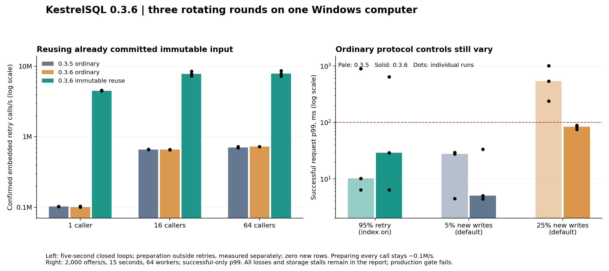

# KestrelSQL 0.3.6: reusable immutable embedded batches

`PreparedBatch` hashes an owned, validated payload once; `LiveArchive::append_prepared(&batch)` can reuse that fingerprint against the optional confirmed receipt index. On three rotating comparisons, 64 callers complete a median 7,848,414 confirmed retry calls/s versus 707,532 for the frozen 0.3.5 ordinary API (11.09x). These calls acknowledge already committed data and ingest **zero new rows during timing**. This is an embedded replay optimization, with explicit preparation costs; it does not establish new-write capacity, network throughput, production readiness or superiority to other databases.

## Contract and cost boundaries

The public type has private immutable state behind Arc. Construction accepts a valid 1..128-byte ASCII batch ID and 1..10K rows in 1..64 equal-length columns, consumes the caller's vectors and computes the same SHA-256 domain as ordinary ingestion. It exposes only borrowed columns and metadata; it has no digest input, mutable payload accessor or deserialization. Clones share the payload. A prepared value is process-local reusable input, **not a durable receipt, cache of successful ACKs, or permission to skip publication**.

Archive width is checked at submission. Known IDs compare rows and the library-computed digest with the durable original receipt. Changed content, row order, shape or width fails; equality returns the original generation. Writer health is checked before and after lookup validation. Unknown and pending IDs copy into the ordinary bounded writer path, which validates/hashes again and synchronizes before ACK. The first submission therefore adds preparation work; it has no claimed fresh-write advantage. Construction can be repeated after restart; the lookup comes from the durable ledger. Prepared values work across separate archives as ordinary input, with each archive's own ledger and publication.

The index remains **off by default**, collection delay remains zero, and CAT4/SEG2 are unchanged. The index stores only receipts, not prepared payloads. Callers own and budget prepared buffers; `payload_bytes()` is logical i64 bytes and excludes spare Vec capacity, IDs, metadata and allocator overhead. The benchmark's retained logical payload is 2,400 bytes shared across callers. Admission limits cover queued payloads rather than all caller allocations. `prepared_retry_hits` is a subset of `fast_retry_hits`.

## Measured bottleneck and rejected experiment

Five rotated CPU-only rounds over five payload shapes compared the original per-i64 SHA-256 updates with portable 512-byte and 4KiB staging. All 75 cases matched the byte domain. For the usual 3-column/100-row payload, 4KiB staging improved only 1.020x (8,956.88 to 8,778.56 ns median); a 3-column/1-row digest slowed from 246.90 to 284.91 ns. Wider and larger cases gained at most about 6%. This experiment is preserved and **not promoted**. SHA-256 processing remains substantial on this machine, so the new API amortizes a library-computed fingerprint over immutable reuses. Ordinary ingestion retains its original digest loop.

The design uses immutable ownership to avoid repeated work. Arrow documents immutable column arrays and shallow batch operations, providing useful context for batch-oriented APIs; this release has no Arrow adapter. [Arrow in-memory data model](https://arrow.apache.org/docs/python/data.html), [sha2 0.10.9](https://docs.rs/crate/sha2/0.10.9).

## Embedded comparison

Fresh 1M-row / 50K-ID fixtures per case; one additional known 100-row batch is committed before timing. 1/16/64 caller threads, five-second closed loops, three rotated rounds. Every receipt is checked; full scrubs and compression run after callers stop. All calls/within-window completions are counted; last-drain completions are excluded from calls/s. Latencies sample every 64 calls per worker; sub-microsecond values reflect Windows timer granularity and are descriptive, not precise nanosecond qualification. No JSON, network or Python request loop runs inside timing.

Frozen 0.3.5 ordinary probe and current ordinary control clone/hash every call. Current prepared mode reuses one constructed immutable batch per fixture, shared by callers, with no payload clone or hash inside retries. These are different input cost contracts. Median one-time construction was 11.50 us; raw reports also include throughput with that one preparation added to the five-second denominator. Construction/copy costs are explicitly included on every call in `prepare_each`, whose one-caller median is 102,542 calls/s and sampled p99 15.10 us. Reconstructing a batch for each retry does not deliver the reuse gain. The baseline probe source is preserved; the current probe adds mode selection and preparation counters, and ordinary controls expose its overhead.

| Callers | 0.3.5 ordinary calls/s | 0.3.6 ordinary calls/s | 0.3.6 prepared calls/s | Prepared / baseline | Baseline / prepared sampled p99 us |
|---:|---:|---:|---:|---:|---:|
| 1 | 102,937 | 100,815 | 4,499,500 | 43.71x | 15.50 / 0.20 |
| 16 | 662,131 | 659,256 | 7,777,161 | 11.75x | 35.50 / 6.30 |
| 64 | 707,532 | 726,232 | 7,848,414 | 11.09x | 43.90 / 7.60 |

## Protocol and fresh-write controls

The loopback JSON adapter uses ordinary ingestion and cannot receive trusted prepared fingerprints. Three rotating 15-second runs at 2,000 offers/s compare old/new **enabled** retry-heavy variants, then old/new **default** anonymous 5%-write and identified 25%-write variants. Each case has fresh 1M-row fixtures; identified cases retain 50K IDs. Retry controls commit 128 known batches outside arrivals. 64 client workers, 256 queue slots, two-second expiry and eight-second socket timeout; raw successful/errors/drop/expiry accounting is retained. Percentiles use successful requests; medians summarize runs rather than pooled samples. No extra database benchmark is inferred from the embedded result.

| Scenario / variant | Median req/s | Median run p99 ms | p99 range ms | Loss / offers | Runs zero loss + p99 <=100ms |
|---|---:|---:|---:|---:|---:|
| retry_control/retry-mixed/baseline-indexed0 | 1999.80 | 10.10 | 6.34-894.82 | 5,445 / 90,000 | 2 / 3 |
| retry_control/retry-mixed/indexed0 | 1999.93 | 28.89 | 6.37-643.31 | 2,272 / 90,000 | 2 / 3 |
| write_controls/anonymous-mixed/baseline | 1999.67 | 27.62 | 4.45-29.28 | 0 / 90,000 | 3 / 3 |
| write_controls/anonymous-mixed/delay0 | 1999.73 | 5.05 | 4.41-33.20 | 0 / 90,000 | 3 / 3 |
| write_controls/receipt-write/baseline | 1931.87 | 537.22 | 239.04-1004.57 | 16,455 / 90,000 | 0 / 3 |
| write_controls/receipt-write/delay0 | 1999.33 | 83.53 | 75.32-88.71 | 0 / 90,000 | 3 / 3 |

| Scenario / variant | Median new-append arrival p99 ms | Median replay call p99 ms | Segment/catalog sync share of publication stages |
|---|---:|---:|---:|
| retry_control/retry-mixed/baseline-indexed0 | 77.63 | 0.78 | 77.17% |
| retry_control/retry-mixed/indexed0 | 398.27 | 0.76 | 76.49% |
| write_controls/anonymous-mixed/baseline | 91.94 | - | 81.16% |
| write_controls/anonymous-mixed/delay0 | 74.73 | - | 74.40% |
| write_controls/receipt-write/baseline | 664.68 | - | 68.20% |
| write_controls/receipt-write/delay0 | 125.59 | - | 50.84% |

Operation-specific tails prevent a favorable combined p99 from concealing slow new writes. Replay call time includes client encoding, network and database work after worker dispatch, not shared-worker queueing or server-only time. Synchronization shares sum the seven process-local publication stages across three loads after subtracting setup counters; they include writer maintenance and do not identify the device-level cause. The ordinary enabled retry median combined p99 regresses from 10.10 to 28.89ms, while both versions have one lossy/stalled run. Default identified-write controls improve in these short repeats, but the new API is unused and storage/publication code is unchanged; those observations do not establish a causal write-performance fix.

The prepared optimization cannot remove ordinary protocol payload hashing or storage synchronization. Write/control failures remain part of the release evidence. Previous DuckDB, SQLite, PostgreSQL, MariaDB and other comparisons remain historical in their own reports; this pass compares the measured Kestrel bottleneck with its previous version.

## Correctness, recovery and provenance

- 45 Rust tests pass in debug/release, including validation boundaries, shared immutable ownership, order/content/shape conflicts, width mismatch, original generations, default queued behavior, cross-archive submission, reopen and 32 concurrent first submissions publishing exactly once. Format and Clippy pass for default and fault builds.
- Fifteen prepared-path cases cover a deterministic stalled writer, seven injected disk-full errors and seven exact publication process exits. Known ordinary/prepared retries and conflicts finish before stall release; poisoned writers reject known and new prepared input. Reopening preserves whole batches, original generations and exact retry identity, with full scrubs.
- Thirty-two concurrent ordinary process-kill cycles on the current writer at 0/2/8/20ms check acknowledged data, whole batches/sums, original receipt generations, retries after a second reopen and scrubs. Five hundred current SQL cases match each of DuckDB and SQLite.
- Thirty embedded cases and 18 open-loop cases / 540,000 offers / 360 independent NumPy windows reconcile. Every receipt, sample percentile and counter delta is audited; build/timing/correctness order proves serial workloads. Only task-owned local processes are used and stopped.
- The 0.3.5 ZIP, core source, supported binaries, direct probe and verification are preserved. Archive storage/query code outside the small receipt-validation helper is byte-identical; unchanged source hashes are recorded. Earlier 56 publication cut cases, 22 corruptions, Parquet/100M results and their timings remain prior evidence, not fresh test counts.

**Service qualification remains failed.** No physical power-loss qualification, long endurance, retention contract, full SQL types, native Parquet/Arrow, authentication, distributed execution or Facebook-scale evidence is supplied by this improvement.

## Reproduction and next work

Preserve the preceding immutable package with `python benchmarks/preserve_035.py` before edits. Run `python benchmarks/profile_digest.py`, then `python benchmarks/checks_036.py`, then `python benchmarks/direct_prepared_compare.py`, then `python benchmarks/run_036.py timed`, then `python benchmarks/run_036.py correctness`, then `python benchmarks/report_036.py`. Use pinned local comparison dependencies. Runners refuse to overwrite prior attempts. Run one timed workload at a time; compile/check/package after timed work has stopped.

Continue profiling new-ID synchronization/checkpoint tails; keep index-off defaults while write controls fail. Add a practical source-checkpoint/consumer-fencing contract and bounded receipt retention before broader adapters. Use the ordinary control and preparation-inclusive control when extending batch reuse; do not equate millions of confirmed retries with millions of durable writes.

[Audit](benchmarks/prepared-036-audit.json), [build proof](benchmarks/rust-checks-036.json), [CPU trial](benchmarks/digest-036-profile.json), [embedded comparisons](benchmarks/prepared-036-direct.json), [retry protocol control](benchmarks/prepared-036-retry-control.json), [fresh-write controls](benchmarks/prepared-036-write-controls.json), [prepared faults](benchmarks/prepared-036-faults.json), [concurrent recovery](benchmarks/group-036-recovery.json), [SQL differential](benchmarks/archive-036-verification.json), [timed order](benchmarks/timed-036-run-order.json), [correctness order](benchmarks/correctness-036-run-order.json), [baseline provenance](benchmarks/baseline-0.3.5-provenance.json), [preceding release](PERFORMANCE_035.md).
