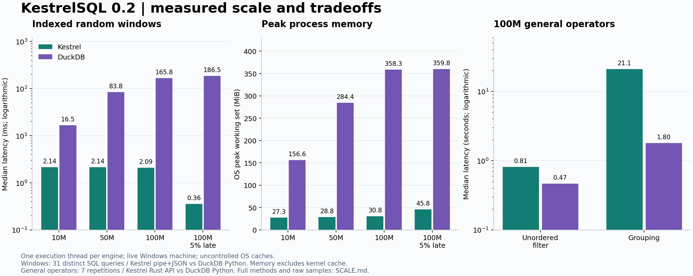

# Large-data qualification: KestrelSQL 0.2

Local qualification completed on 6 October 2026. Kestrel persists up to **100 million rows**, keeps raw values on disk, and answers exact time-window aggregates through automatically maintained indexes. This is a specialized advantage over the measured DuckDB configuration; it is not a general database ranking or production certification.

Environment: Windows-10-10.0.19045-SP0; Intel64 Family 6 Model 165 Stepping 5, GenuineIntel; 20 logical CPUs available, **one query execution thread per engine**. Machine physical RAM was approximately 31.9 GiB. Reference: DuckDB 1.5.6, Python 3.12.10; Rust 1.97.1. No CPU affinity, dedicated host, or OS-cache clearing.

## Randomly placed windows: preferred comparison

Each dataset received 31 distinct SQL queries with seeded random lower/upper bounds and widths between 5% and 75% of the timestamp domain. Each asks COUNT, SUM, and AVG. Every result matched DuckDB. New literal SQL is parsed for every query; there is no Kestrel query-result cache. Engine order alternates between samples. Kestrel timing includes a Python caller, pipe round trip, and JSON; DuckDB uses its Python binding. These are warm, existing disk stores.

| Dataset | Kestrel median, ms | DuckDB median, ms | Kestrel p95, ms | DuckDB p95, ms | Median paired ratio |
|---|---:|---:|---:|---:|---:|
| 10M / ordered | 2.138 | 16.539 | 2.539 | 31.439 | 8x |
| 50M / ordered | 2.142 | 83.833 | 2.499 | 159.033 | 35x |
| 100M / ordered | 2.095 | 165.798 | 2.411 | 321.515 | 79x |
| 100M / 5% late | 0.359 | 186.481 | 0.453 | 424.970 | 515x |

The ratio column is the median of per-query DuckDB/Kestrel latency ratios; it is not necessarily the quotient of the two medians. p95 describes a population of different windows, not repeated latency for one fixed SQL statement. It does not establish service tail latency.

The underlying advantage is precomputation: subtract sparse cumulative totals, read/check only boundary pages, and combine independent sorted runs. DuckDB uses its built-in zonemaps but scans selected values for these aggregates. Equivalent maintained aggregate structures can also accelerate other databases: the historical SQLite prefix-table baseline in [BENCHMARK.md](BENCHMARK.md) demonstrates that. This suite does not compare such structures across all engines.

## Persisted size, process memory, and maintenance

| Dataset | Kestrel peak working set, MiB | DuckDB peak working set, MiB | Kestrel files, GB | DuckDB file, GB | Kestrel ingest, s | DuckDB load, s | Full Kestrel scrub, s |
|---|---:|---:|---:|---:|---:|---:|---:|
| 10M / ordered | 27.3 | 156.6 | 0.240 | 0.032 | 1.23 | 1.43 | 0.17 |
| 50M / ordered | 28.8 | 284.4 | 1.201 | 0.160 | 7.40 | 5.97 | 2.09 |
| 100M / ordered | 30.8 | 358.3 | 2.403 | 0.320 | 33.15 | 44.51 | 10.36 |
| 100M / 5% late | 45.8 | 359.8 | 2.403 | 0.534 | 16.36 | 61.36 | 1.29 |

The 100M ordered archive contains 2,400,000,000 raw payload bytes in 100 segments. Its segment metadata uses 2,759,479 serialized bytes. The measured peak working set is 30.8 MiB across generation, ingestion, all six query cases, and full payload/index verification. The process does not load the entire raw table into user-space RAM.

Peak working set comes from the OS high-water counter sampled while the independent child process is alive. It includes that engine process and excludes the parent and kernel file cache. DuckDB uses a 256 MB buffer-manager limit; this is not a total-process memory cap ([DuckDB memory management](https://duckdb.org/2024/07/09/memory-management)). Kestrel has batch and index allocation guards rather than a total-process governor. These measurements do **not** show total host memory use or data exceeding physical machine RAM.

Ingestion includes synthetic generation, sorting/index maintenance, synchronization, and persistence. DuckDB uses native CTAS and compression; Kestrel writes uncompressed integers and one immutable segment per million rows. These storage designs and ingest paths differ, so load times describe each implementation rather than isolate identical write work. Kestrel physical bytes include old catalog generations; segment metadata bytes exclude catalog envelopes and allocation overhead.

## Fixed operator matrix: wins and losses

The original scale matrix has three warmups and seven measured repetitions per fixed SQL statement. Below are medians in **milliseconds**. Kestrel uses its direct Rust API here; DuckDB uses Python. Prefer the conservative pipe comparison above for the headline.

| Dataset | Query | Kestrel, ms | DuckDB, ms | Kestrel payload bytes read |
|---|---|---:|---:|---:|
| 10M / ordered | all_aggregates | 0.0075 | 44.8488 | 0 |
| 10M / ordered | broad_window | 0.1465 | 29.1191 | 131,072 |
| 10M / ordered | narrow_window | 0.0727 | 0.4499 | 65,536 |
| 10M / ordered | unordered_filter | 84.3581 | 44.0304 | 80,000,000 |
| 10M / ordered | grouped | 412.6754 | 84.5786 | 160,000,000 |
| 10M / ordered | min_max | 0.0060 | 23.6767 | 0 |
| 50M / ordered | all_aggregates | 0.0206 | 217.9529 | 0 |
| 50M / ordered | broad_window | 0.1274 | 130.5705 | 131,072 |
| 50M / ordered | narrow_window | 0.0626 | 0.7528 | 65,536 |
| 50M / ordered | unordered_filter | 414.0450 | 206.8339 | 400,000,000 |
| 50M / ordered | grouped | 2122.7903 | 415.4883 | 800,000,000 |
| 50M / ordered | min_max | 0.0120 | 139.7440 | 0 |
| 100M / ordered | all_aggregates | 0.0504 | 494.1918 | 0 |
| 100M / ordered | broad_window | 0.0250 | 303.3895 | 0 |
| 100M / ordered | narrow_window | 0.0747 | 0.8960 | 65,536 |
| 100M / ordered | unordered_filter | 814.1960 | 465.1718 | 800,000,000 |
| 100M / ordered | grouped | 21059.4086 | 1804.2579 | 1,600,000,000 |
| 100M / ordered | min_max | 0.0367 | 307.1568 | 0 |
| 100M / 5% late | all_aggregates | 0.0302 | 371.6862 | 0 |
| 100M / 5% late | broad_window | 0.1826 | 227.6681 | 131,072 |
| 100M / 5% late | narrow_window | 0.0628 | 0.6599 | 65,536 |
| 100M / 5% late | unordered_filter | 679.7793 | 367.5805 | 800,000,000 |
| 100M / 5% late | grouped | 3415.2815 | 816.8757 | 1,600,000,000 |
| 100M / 5% late | min_max | 0.0785 | 220.0613 | 65,536 |

The fixed 100M ordered broad window lands exactly on segment boundaries and reads no payload bytes. It is an unusually favorable metadata-only query, which is why randomized unaligned windows were added. Whole-run totals and extrema can also use metadata alone. Fast aggregates validate metadata and any pages they read; a separate full scrub validates every payload page and its derived index.

DuckDB wins every measured unordered-filter and grouped case. The 100M ordered grouped measurement is particularly slow for Kestrel on this shared machine; the raw samples are retained. No timing was discarded to improve a ratio. Page-at-a-time I/O, scalar operator execution, hash grouping, compression, and cache effects require profiling before broader speed claims.

The late scenario changes 5% of timestamps from i to i−10,000, sorts each batch independently, and leaves overlapping runs. It establishes correctness and index eligibility for that distribution; it does not simulate arbitrary late-event ages, duplicates, corrections, or a continuous streaming service.

## Real NYC taxi pipeline

The pipeline processes January 2025 yellow taxi Parquet and the TLC zone lookup from [NYC TLC](https://www.nyc.gov/site/tlc/about/tlc-trip-record-data.page). Source definitions come from the [yellow taxi data dictionary](https://www.nyc.gov/assets/tlc/downloads/pdf/data_dictionary_trip_records_yellow.pdf). Source SHA-256 values, rejection predicates, exported binary hash, query SQL, raw samples, and DuckDB plans are recorded in [nyc-results.json](benchmarks/nyc-results.json).

Input: 3,475,226 rows. Accepted: 3,475,077. Rejected: 149 (22 outside the pickup period, 127 invalid durations; predicate counts may overlap). All accepted pickups map to a published zone. 63,036 negative-charge records remain; the chosen rules do not silently remove financial adjustments.

Local pickup timestamps are interpreted in America/New_York and stored as UTC epoch seconds. Source total_amount is converted through DECIMAL(18,2) into integer cents; it excludes cash tips under the source definition. The gold metric is **total charged cents**, not profit, recognized revenue, or an audited financial statement. Daily gold trip counts reconcile to silver and the binary export.

| Query | Kestrel median, ms | DuckDB median, ms | Kestrel payload bytes read |
|---|---:|---:|---:|
| month | 0.111 | 17.769 | 0 |
| day | 0.660 | 1.698 | 393,216 |
| hour | 0.627 | 0.737 | 393,216 |
| zone | 3.886 | 2.067 | 3,440,640 |
| all_zones | 126.447 | 28.308 | 55,601,232 |

Real-data queries have three warmups, 15 repetitions, and alternating first-engine order. Kestrel includes the Python/pipe/JSON interface; DuckDB uses its Python binding over a persisted globally time-sorted table. Kestrel ingests original source order into independently sorted runs. DuckDB wins the zone-filtered and grouped cases. Neither ingestion nor gold transformations are included in these query timers.

## Verification and reproducibility

- 23 Rust tests passed in both debug and release; formatting and Clippy with warnings as errors passed.
- 500 Archive SQL cases matched each of DuckDB and SQLite over 40,024 rows in eight overlapping runs; full scrub passed after each append.
- All 24 fixed large-scale query cases, 124 randomized window cases, and five real-data query cases matched DuckDB. Each scale scenario reopened correctly in a fresh process.
- Every scale payload and the real-data import underwent full CRC/index verification.
- The earlier RAM-engine 1,002-query comparison remains historical evidence in the 0.1 report; the final 0.2 release also reruns all its Rust regression tests.

See [ARCHIVE.md](ARCHIVE.md) for commands and API limits. Raw machine-readable reports: [fixed scale](benchmarks/large-results.json), [random windows](benchmarks/random-window-results.json), [real data](benchmarks/nyc-results.json), [Archive differential cases](benchmarks/archive-verification.json), and [qualification record](verification.json). The scale harness supports `--resume` to preserve completed scenarios after interruption and uses a fresh work directory for missing scenarios.

The three ordered fixed-matrix scenarios preceded two input-validation fixes (unequal empty batch shapes and the wide-schema import batch cap). All timing runs preceded a final schema-name case-normalization fix. Query execution, sorting, and the lowercase three-column benchmark schemas were unchanged. The packaged binary rechecked all 24 fixed, 124 randomized, and five real-data results without retiming, and reran the 500-query differential suite. [release-recheck.json](benchmarks/release-recheck.json) records its SHA-256 and successful wide-schema/partial-row import checks. The interrupted incomplete late run is excluded; its replacement is recorded in full.

## Scope of the result

This is a single-machine 100M-row experiment with three non-null integer columns. It does not qualify distributed big-data processing, production availability, cold storage I/O, mixed writes and queries, many clients, power-loss durability, idempotent retries, compaction, schema migration, or backup/restore. [README.md](README.md) lists production release gates. The immediate deliverable is a reproducible engine design and a data-engineering case study.
