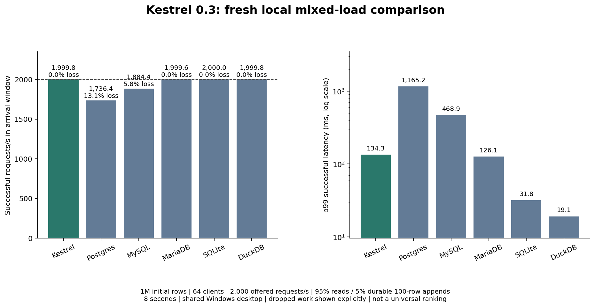
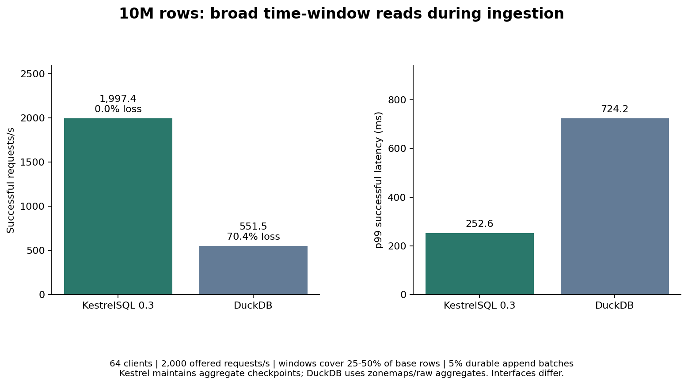

# KestrelSQL 0.3: live ingestion and measured limits

**0.3 improves concurrent aggregate service and adds replayable ingestion; sustained service qualification remains a production gate.** In the final retained-handle 2,000-request/s mixed test, Kestrel completed 1,999.75 successful requests/s versus 881.12 in the 0.2 baseline. Its successful-request p99 was 134.31 ms, with 0/16,000 failed or unexecuted offers. A short local run is insufficient to qualify production service.

| Final Kestrel case | Zero loss and p99 at most 100 ms |
|---|---|
| Mixed 2,000/s, 8 seconds | FAIL |
| Mixed 500/s, 60 seconds | PASS |
| 10M analytics 1,000/s, 30 seconds | FAIL |

The final 2,000/s mixed and lower-rate broad-window analytics cases still miss the 100 ms p99 target. The single-client mixed and 10,000/s overload cases also lose work; all results are included below. These remaining failures are priorities for the next storage and scheduling experiments.

The changes are immutable read snapshots, durable coalesced publication, batch IDs with SHA-256 payload identities, bounded small-run compaction, reference-aware reclamation, retained boundary handles and a 32 MiB retained decoded-page/prefix cache. [LIVE_METRICS.md](LIVE_METRICS.md) explains the APIs and [RESEARCH.md](RESEARCH.md) connects them to primary literature.

## Mixed workload: fresh six-engine comparison

KestrelSQL 0.3.0, PostgreSQL 17.6, MySQL 8.4.11, MariaDB 11.8.9-MariaDB, SQLite 3.49.1, DuckDB v1.5.6. One million initial rows in each fresh fixture, 64 clients, 95% time-range COUNT/SUM requests and 5% durable 100-row appends, 5% late append timestamps. The 2,000/s case lasts eight seconds. Engines run sequentially on one shared Windows desktop; these results are not a ranking under controlled hardware conditions.

| Engine / case | Successful requests/s in arrival window | p99 success latency, ms | Failed / unexecuted | ACK batches |
|---|---:|---:|---:|---:|
| KestrelSQL 0.3 | 1,999.75 | 134.31 | 0 (0.00%) | 803 |
| PostgreSQL | 1,736.38 | 1,165.23 | 2,098 (13.11%) | 695 |
| MySQL | 1,884.38 | 468.86 | 922 (5.76%) | 751 |
| MariaDB | 1,999.62 | 126.06 | 0 (0.00%) | 803 |
| SQLite | 2,000.00 | 31.78 | 0 (0.00%) | 803 |
| DuckDB | 1,999.75 | 19.09 | 0 (0.00%) | 803 |



## Repeated runs and the unresolved tail

| Run | Success/s | p99 success, ms | Failed / unexecuted |
|---|---:|---:|---:|
| 0.2 baseline | 881.12 | 611.30 | 8,631 / 16,000 |
| 0.3 cache + 2 ms delay (earlier code) | 1,999.62 | 17.13 | 0 / 16,000 |
| 0.3 zero delay, first full run | 1,916.88 | 402.24 | 647 / 16,000 |
| 0.3 zero delay, repeat before retained handles | 1,953.88 | 281.07 | 367 / 16,000 |
| 0.3 retained handles for all reads | 1,999.75 | 9.44 | 0 / 16,000 |
| 0.3 final: boundary handles / independent scans | 1,999.75 | 134.31 | 0 / 16,000 |

The 17 ms result used an earlier implementation with a 2 ms batching delay. Both subsequent zero-delay runs are retained, including the markedly slower first run. The final full Kestrel matrix, including single-client and generic scans, is listed below. The second zero-delay run was an explicit reproducibility check. The final implementation retains immutable segment handles for boundary reads at explicit offsets and gives long scans independent handles; a new 512-query concurrent-read regression covers distinct pages and columns. The first retained-handle iteration regressed the generic scan case; it is retained and audited. The final correction restores independent synchronous scan handles on Windows. Reference results in the final comparison are reused from the same-session native-engine runs performed before that Kestrel-only change; original raw sample paths are preserved. There is no statistical confidence interval or isolated causal estimate for either change. Some fresh reference results also vary substantially from their earlier baseline; the host, OS caches, storage and client scheduling are uncontrolled. We have not established the cause of every stall.

Publication diagnostics capture synchronized segment/catalog work; the first zero-delay run includes publication calls exceeding seven seconds in some low-rate cases. Compaction does not hold readers' execution lock, but still occupies the writer. Next work is stage-by-stage storage profiling and repeated interleaved testing, as specified in the research notebook. Turning off durability would change the contract.

## Full final Kestrel matrix

| Profile | Clients | Offered requests/s | Seconds | Success/s | p99 success, ms | Failed / unexecuted |
|---|---:|---:|---:|---:|---:|---:|
| read | 1 | 500 | 8 | 500.00 | 1.95 | 0 |
| read | 16 | 500 | 8 | 500.00 | 2.08 | 0 |
| read | 64 | 500 | 8 | 500.00 | 1.78 | 0 |
| mixed | 1 | 500 | 8 | 437.62 | 701.77 | 255 |
| mixed | 16 | 500 | 8 | 500.00 | 7.27 | 0 |
| mixed | 64 | 500 | 8 | 500.00 | 5.97 | 0 |
| write | 64 | 500 | 8 | 499.62 | 283.09 | 0 |
| scan | 64 | 200 | 8 | 199.25 | 167.97 | 0 |
| mixed | 64 | 2000 | 8 | 1999.75 | 134.31 | 0 |
| mixed | 64 | 10000 | 8 | 5520.50 | 323.20 | 35513 |
| mixed | 64 | 500 | 60 | 500.00 | 14.28 | 0 |

The generic scan profile mixes full grouping, an unordered value filter and range reads with 10% appends. These operators are a separate performance boundary from indexed COUNT/SUM ranges. Single-client mixed latency includes its serialized durable writes.

## One-minute soak and overload

500 offered requests/s, 64 clients, 60 seconds:

| Engine / case | Successful requests/s in arrival window | p99 success latency, ms | Failed / unexecuted | ACK batches |
|---|---:|---:|---:|---:|
| KestrelSQL 0.3 | 500.00 | 14.28 | 0 (0.00%) | 1,483 |
| PostgreSQL | 500.00 | 84.65 | 0 (0.00%) | 1,483 |
| MySQL | 482.12 | 1,341.40 | 1,069 (3.56%) | 1,431 |
| MariaDB | 500.00 | 53.43 | 0 (0.00%) | 1,483 |
| SQLite | 500.00 | 11.73 | 0 (0.00%) | 1,483 |
| DuckDB | 499.97 | 170.29 | 0 (0.00%) | 1,483 |

10,000 offered requests/s, 64 clients, eight seconds:

| Engine / case | Successful requests/s in arrival window | p99 success latency, ms | Failed / unexecuted | ACK batches |
|---|---:|---:|---:|---:|
| KestrelSQL 0.3 | 5,520.50 | 323.20 | 35,513 (44.39%) | 2,230 |
| PostgreSQL | 4,052.62 | 180.64 | 47,226 (59.03%) | 1,672 |
| MySQL | 5,109.38 | 106.60 | 38,805 (48.51%) | 2,088 |
| MariaDB | 3,045.38 | 205.09 | 55,316 (69.14%) | 1,235 |
| SQLite | 7,409.88 | 121.18 | 20,422 (25.53%) | 3,008 |
| DuckDB | 4,289.75 | 104.40 | 45,362 (56.70%) | 1,807 |

Loss, expiry and errors are included in the failed/unexecuted column. Percentiles describe successful requests only, including drain completions. Throughput counts successes completed in the arrival window. Each read or complete 100-row append is one request; these are not inserted-row rates. Client queue capacity is 256, with two-second queued-request expiry and eight-second connection/statement deadlines. Python load-generator dispatch and interface costs are part of observed latency.

## The specialized 10M-row analytical workload

Random windows cover 25-50% of the ten-million-row base, or 2.5-5 million rows per read. The offered mixture is 95% COUNT/SUM reads and 5% durable 100-row appends, at 2,000 requests/s, 64 clients, eight seconds. Both engines use one execution thread per query. The same exact row results and acknowledged-write reconciliation are checked after the run.

| Engine / case | Successful requests/s in arrival window | p99 success latency, ms | Failed / unexecuted | ACK batches |
|---|---:|---:|---:|---:|
| KestrelSQL 0.3 | 1,997.38 | 252.60 | 0 (0.00%) | 774 |
| DuckDB | 551.50 | 724.16 | 11,267 (70.42%) | 228 |



Kestrel's maintained sparse aggregate checkpoints avoid scanning the full selected window. DuckDB uses its normal aggregate execution and zonemaps. Index maintenance and storage are different; this experiment does not compare equivalent maintained materialized views. It tests our intended automatic time-window feature, not general SQL superiority. Historical 100M timing evidence is retained in [SCALE.md](SCALE.md); new untimed regression checks matched all 153 retained scale/real-data cases with the 0.3 CLI.

The deliberate lower-rate follow-up uses 1,000 offered requests/s for 30 seconds, with the same ten-million-row fixture and read/write mixture. Its purpose is to estimate a more reliable operating range; it does not replace or hide the 2,000/s failures:

| Engine / case | Successful requests/s in arrival window | p99 success latency, ms | Failed / unexecuted | ACK batches |
|---|---:|---:|---:|---:|
| KestrelSQL 0.3 | 999.97 | 121.19 | 0 (0.00%) | 1,489 |
| DuckDB | 590.93 | 687.41 | 11,954 (39.85%) | 926 |

## Correctness and the pipeline

- 30 Rust tests pass in debug and release, including concurrent identified writes, stable snapshots, compaction, receipt preservation and corruption detection after cache warming. Formatting and Clippy with warnings treated as errors pass. The runnable Rust example also checks replay and pinned versus fresh read views.
- 24 actual forced process kills: every acknowledged batch recovered, published batches remained whole, full scrubs passed, and replay of all attempted IDs produced one copy per batch. Unknown unacknowledged commits are explicitly counted. This models process death, not power loss.
- The Parquet demo ingested 25,000 base plus 5,000 late rows; both source replays were deduplicated. 42 SQL cases matched DuckDB after reopening. A prior window changed from [[2000, -1000]] to [[4000, -2000]]; changed content under an existing ID was rejected.
- Legacy catalogs were read, new receipt catalogs survived reopening, and an older binary rejected the upgraded format. Wider 64-column import and partial-row rejection checks passed.
- The current benchmark audit checked 538,641 executed samples over 26 cases and 785,600 offers, plus 68,779 samples over four broad-window cases. All acknowledged batches and 600 independent NumPy windows reconciled. Earlier 0.3 iterations are audited separately and retained.

## Reproduce and inspect

```powershell
cargo build --release --locked
cargo test --release --locked
python -m pip install -r benchmarks/stress_requirements.txt
python benchmarks/portable_servers.py start
python benchmarks/stress_compare.py --engines kestrel --output benchmarks/my-kestrel.json
python benchmarks/stress_compare.py --engines postgres,mysql,mariadb,sqlite,duckdb --targets --resume --output benchmarks/my-kestrel.json
python benchmarks/stress_compare.py --engines kestrel,duckdb --analytics --rows 10000000 --output benchmarks/my-analytics.json
python benchmarks/stress_compare.py --engines kestrel,duckdb --analytics --analytics-rps 1000 --seconds 30 --rows 10000000 --resume --output benchmarks/my-analytics.json
python benchmarks/hard_recovery.py --identified --output benchmarks/my-recovery.json
python benchmarks/live_pipeline_demo.py
python benchmarks/portable_servers.py stop
python benchmarks/report_v03.py --plot
```

The helper downloads pinned official portable packages to task-local folders and starts loopback-only processes, without installing Windows services. Setup/import is outside timed arrivals. References use durable commits and covering range indexes where applicable; [reference-packages.json](benchmarks/reference-packages.json) records pinned package hashes, hardware and native settings. CLI overrides accept freshly built binaries; default commands use bundled `bin` executables. A full rerun takes time and several gigabytes of temporary storage.

Reports: [current mixed/raw sample paths](benchmarks/stress-v03-release.json), [10M analytics](benchmarks/stress-v03-release-analytics.json), [all-reads handle regression](benchmarks/stress-v03-handles.json), [prior handles analytics](benchmarks/stress-v03-handles-analytics.json), [prior zero-delay/native comparison](benchmarks/stress-v03-confirmation.json), [prior analytics](benchmarks/stress-v03-analytics.json), [audit](benchmarks/v03-audit.json), [earlier cache iteration](benchmarks/stress-v03-results.json), [first zero-delay run](benchmarks/stress-v03-final.json), [identified crash/retry tests](benchmarks/hard-recovery-v03.json), [pipeline](portfolio/live-pipeline-results.json), [retained-data regression](benchmarks/release-recheck-v03.json), [format compatibility](benchmarks/format-v03.json), [current capability probes](benchmarks/capability-v03.json). The historical [0.2 matrix](HARD_TESTS.md) remains unchanged.

## Readiness boundaries

This remains an embedded BIGINT aggregate prototype. Archive does not support raw row retrieval, joins, strings, nullable input, updates/deletes or SQL transactions. The stress adapter is unauthenticated test infrastructure. Stable error codes, production health, native Arrow/Parquet APIs, comprehensive retention/orphan cleanup, backups, migrations, long endurance, physical power loss and Linux qualification remain work. Durable IDs stop at a disclosed 100,000-record budget; this suite does not qualify the performance of a full receipt ledger.

ClickHouse, SQL Server, Oracle and distributed clusters were not executed on this computer. Our workload is not TAOBench and cannot certify Facebook-scale operation. Shared-machine timings, different API boundaries, warm caches, selected short workloads and unequal SQL coverage limit every speed claim here.
